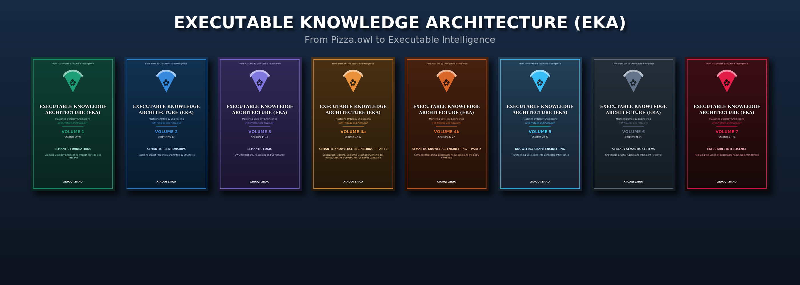
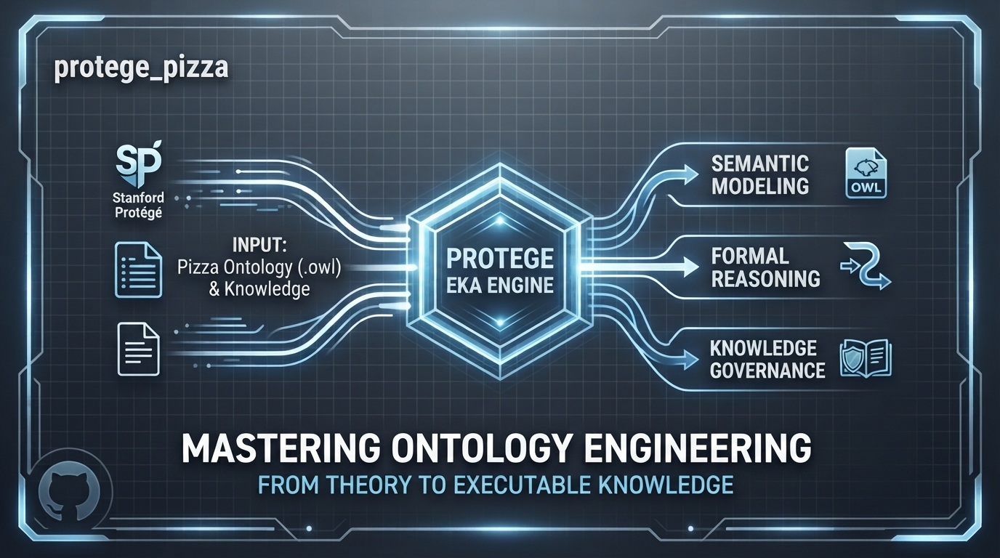

# 🍕 Mastering Ontology Engineering with Protégé and Pizza.owl

## Executable Knowledge Architecture (EKA)

### From Pizza.owl to Executable Knowledge

An open-source ontology engineering learning and knowledge-development platform built around the Protégé Pizza.owl tradition, extending hands-on OWL modeling into semantic governance, reasoning, knowledge graphs, and Executable Knowledge Architecture (EKA).

[](https://github.com/yasenstar/protege_pizza/stargazers)  

[](https://www.youtube.com/playlist?list=PL6DEHvciXKeUx4P32B3hKMK1t6mC8RhwW) [](https://xiaoqi.com)

[](https://leanpub.com/store?category=&search=executable+knowledge+architecture&sort=bestsellers_last_week&language=&lng=en) [](https://www.amazon.com/s?k=Mastering+Ontology+Engineering+with+Prot%C3%A9g%C3%A9+and+Pizza.owl+Xiaoqi&i=digital-text&crid=2OCZWC2LH7LLI&sprefix=mastering+ontology+engineering+with+prot%C3%A9g%C3%A9+and+pizza.owl+xiaoqi%2Cdigital-text%2C400&ref=nb_sb_noss_1)

> 💡 **Looking for the complete, professional guide?** While this repository provides open-source snapshot code (the individual "pieces"), our structured multi-volume eBook series on **Leanpub** and **Amazon Kindle** provides the complete architectural framework, deep-dive explanations, and advanced engineering practices (such as Stage 4 Semantic Governance). 
>
> 
>  
> 👉 **[Get the Full eBook on Leanpub](https://leanpub.com/store?category=&search=Xiaoqi+Mastering+Ontology+Engineering+with+Prot%C3%A9g%C3%A9+and+Pizza.owl&sort=bestsellers_last_week&language=&lng=en)** or **[Get it on Amazon Kindle](https://www.amazon.com/s?k=Mastering+Ontology+Engineering+with+Prot%C3%A9g%C3%A9+and+Pizza.owl+Xiaoqi&i=digital-text&crid=2OCZWC2LH7LLI&sprefix=mastering+ontology+engineering+with+prot%C3%A9g%C3%A9+and+pizza.owl+xiaoqi%2Cdigital-text%2C400&ref=nb_sb_noss_1)** to support this project!

---

# 📢 Exciting News: Plan Protégé Going Global! 🌍

> 🎉 **We've forked the official Protégé Desktop project — and we're taking it multilingual!**

To bring the power of Protégé to a much wider audience, we have forked the original [Protégé Desktop](https://github.com/protegeproject/protege) project into our brand-new open-source organization:

👉 **[github.com/yasen-opensource](https://github.com/yasen-opensource)** — starting with **[yasen-opensource/protege](https://github.com/yasen-opensource/protege)**

## 🗺 The Roadmap

- 🇨🇳 **Chinese Edition First** — a full Simplified Chinese localization of the Protégé Desktop UI
  (menus, dialogs, the OWL editing views — classes, object/data properties, individuals, SWRL rules —
  and more), implemented with standard Java internationalization (`ResourceBundle` / `.properties`),
  so Chinese-speaking developers and ontology engineers can learn and work in their native language.
- 🌍 **Multilingual Branch Next** — the Chinese edition is only the beginning. Our roadmap extends to
  further languages, growing a true multilingual branch of the tool.
- 🛠 **Community-Driven** — built by the community, for the community.

## 🤝 Contributors Welcome!

Whether you are a Java/Swing developer, a translator, a technical writer, or simply a passionate
Protégé user — there is a place for you in this journey:

- 🐛 Report untranslated strings or UI glitches
- 🌐 Contribute translations — refine the Chinese edition, or kick off a new language
- 💻 Help with i18n engineering (ResourceBundle extraction, Maven packaging, Swing runtime support)
- 📖 Improve documentation and onboarding guides

⭐ **Star [yasen-opensource/protege](https://github.com/yasen-opensource/protege) to follow our progress, open a [discussion](https://github.com/yasen-opensource/protege/discussions) to say hello, and jump into the [issues](https://github.com/yasen-opensource/protege/issues) to claim your first contribution!**

---

# 🏛 What is EKA?

**EKA** stands for `Executable Knowledge Architecture`.

EKA is a practical framework for transforming human knowledge into machine-readable, machine-reasonable, and ultimately machine-executable intelligence.

The framework is represented as:

```text
EKA = (K, R, Θ, Φ, Γ)

K = Knowledge
R = Reasoning & Rules
Θ = Triggers
Φ = Actions / Execution
Γ = Governance
```

EKA provides an architectural bridge between:

- Ontology Engineering
- Knowledge Graphs
- Semantic Governance
- AI Systems
- Agent Architectures
- Executable Intelligence

---

# 🌍 The EKA Journey

This project began as an exploration of the legendary `Pizza.owl` tutorial created by Michael DeBellis and the Protégé community.

Over time it evolved into a broader journey, I use `Pizza.owl` as a controlled environment for teaching ontology engineering as an engineering discipline:

```text
Pizza.owl
↓
Ontology Engineering
↓
Knowledge Graphs
↓
Semantic Governance
↓
Reasoning
↓
AI-Ready Systems
↓
Executable Intelligence
```

The Pizza tutorial remains the educational foundation.

EKA is the destination.

---

# 🚀 Project Vision

This repository is the official engineering environment for the **Executable Knowledge Architecture (EKA)** initiative.

The objective is not simply to learn OWL or Protégé.

The objective is to learn how knowledge itself can become:

- Structured
- Governed
- Reused
- Reasoned
- Automated
- Executable

Through the EKA series you will gradually move from ontology fundamentals toward enterprise-scale knowledge architecture and intelligent systems.

---

# 🌟 Why Learn Ontology & Protégé?

In the era of AI and Large Language Models (LLMs), ontologies provide the formal semantic layer that machines need to reason reliably.

By following this repository and companion eBook series, you will learn how to:

- Build ontologies using Protégé
- Model domains semantically
- Design reusable ontologies
- Apply reasoning and inference
- Govern semantic knowledge
- Build knowledge graphs
- Prepare AI-ready semantic systems
- Understand executable knowledge architecture



---

# 📚 Companion eBook Series

## Executable Knowledge Architecture (EKA)

### Mastering Ontology Engineering with Protégé and Pizza.owl

> [!Note] About the 8-volume structure.
> The series has been expanded from the original 7-volume plan to an 8-volume structure. The former Volume 4 (Chapters 17–27, SKDL) has been split into Volume 4a (Chapters 17–22, Stages 1–5) and Volume 4b (Chapters 23–27, Stages 6–7 + Synthesis). The split was made for two reasons:
> (1) Volume 4 had grown past 400 PDF pages, exceeding the Amazon KDP paperback page limit;
> (2) it had become disproportionately larger than Volumes 1–3. Chapter numbering is preserved; the split is a container-level change only.

### Volume 1 — Semantic Foundations (Chapters 00-08)

**Learning Ontology Engineering through Protégé and Pizza.owl**

Introduces ontology engineering fundamentals, Protégé, RDF foundations, class hierarchies, semantic thinking, reasoning, and the EKA framework.

---

### Volume 2 — Semantic Relationships (Chapters 09-13)

**Mastering Object Properties and Ontology Structures**

Introduces object properties, inverse properties, property characteristics, domain, range, and semantic relationship design.

---

### Volume 3 — Semantic Logic (Chapters 14-16)

**OWL Restrictions, Reasoning and Governance**

Explores existential restrictions, universal restrictions, reasoning foundations, semantic requirements, and governance concepts.

---

### Volume 4a — Semantic Knowledge Engineering, Part 1 (Chapters 17-22)

**Foundations & Governance (SKDL Stages 1-5)**

Introduces the Semantic Knowledge Development Lifecycle (SKDL) and walks through its first five stages: Conceptual Modeling, Semantic Description, Knowledge Reuse, Semantic Governance, and Semantic Validation. Ends with the validation discipline that prepares the ground for automated reasoning.

---

### Volume 4b — Semantic Knowledge Engineering, Part 2 (Chapters 23-27)

**Reasoning & Executable Knowledge (Stages 6–7 + Synthesis)**

Completes the SKDL: Semantic Reasoning, then the three-part Executable Knowledge stage (boundary control, value specification, data integrity), and closes with a synthesis of the full lifecycle. Includes the Exercise 26 troubleshooting arc — a three-week diagnostic journey through OWA counting, Stage 1 error propagation, closure-inheritance conflicts, and Protégé's local-vs-global view split.

---

### Volume 5 — Knowledge Graph Engineering (Chapters 28-30)

**Transforming Ontologies into Connected Intelligence**

Focuses on transforming ontologies into operational knowledge graphs and connected semantic systems.

---

### Volume 6 — AI-Ready Semantic Systems (Chapters 31-36)

**Knowledge Graphs, Agents and Intelligent Retrieval**

Connects ontologies, knowledge graphs, reasoning, retrieval, and agent-based architectures.

---

### Volume 7 — Executable Intelligence (Chapters 37-42)

**Realizing the Vision of Executable Knowledge Architecture**

Completes the transformation from semantic knowledge into executable intelligence systems.

---

## 👉 Read the Source Code & Markdown Files Directly

All raw chapters remain open-source and available under [CC BY-NC-SA 4.0](./LICENSE.md).

Read book source: [/ebook/markdown/](ebook/markdown/)

---

# 🎓 Learning Path

This repository is a companion to the complete video series.

Recommended sequence:

```text
Videos
↓
Repository Snapshots
↓
Markdown Chapters
↓
Companion eBooks
↓
Knowledge Graph Projects
↓
Executable Knowledge Architecture
```

---

# 🙏 Intellectual Heritage

This work stands on the shoulders of giants.

Special recognition goes to:

- Matthew Horridge
- Holger Knublauch
- Alan Rector
- Robert Stevens
- Chris Wroe
- Simon Jupp
- Georgina Moulton
- Nick Drummond
- Sebastian Brandt

and particularly:

**Michael DeBellis**

whose Pizza.owl tutorial remains one of the most influential practical introductions to ontology engineering ever created.

We are also honored to feature technical review and forewords from:

**Timothy W. Cook**
Founder of SDC (Semantic Data Charter)

---

# ❤️ Final Thought

> The journey begins with pizza.
>
> But the real subject is meaning.
>
> — Michael DeBellis

And in EKA:

> The journey begins with Pizza.owl.
>
> The destination is Executable Intelligence.
>
> — EKA Project

---

Last updated at 2026-10-17