# Chapter 26 - Stage 7 of SKDL -- Executable Knowledge (Part 3): Data Integrity & Comprehensive Architecture

**Completing the Executable Ontology**

Chapter 24 built the boundary layer of an executable ontology. Chapter 25 built the value layer. This chapter builds the last layer -- **data integrity** -- and then steps back to view the whole of Stage 7 as a single architecture.

By the end of this chapter, we will have consolidated **five execution primitives** into a single anatomy, examined executability from four complementary perspectives (mathematical, historical, industrial, and EKA), and closed the design-pattern family that began in Chapter 22.

This is the final chapter of Stage 7. It completes the SKDL lifecycle and prepares the synthesis that follows in Chapter 27

- [26.1 Chapter Introduction](#261-chapter-introduction)
- [26.2 Learning Objectives](#262-learning-objectives)
- [26.3 Exercise 26 -- Cardinality Restrictions and Data Completeness](#263-exercise-26----cardinality-restrictions-and-data-completeness)
  - [26.3.1 The Engineering Objectives](#2631-the-engineering-objectives)
  - [26.3.2 Implementation: Creating the Cardinality Restriction](#2632-implementation-creating-the-cardinality-restriction)
  - [26.3.3 Why the Reasoner Did Not Classify the Three Pizzas](#2633-why-the-reasoner-did-not-classify-the-three-pizzas)
  - [26.3.4 How to Make the Cardinality Fire](#2634-how-to-make-the-cardinality-fire)
    - [Attempt 1 -- Add a closure axiom (the pattern from Chapter 24)](#attempt-1----add-a-closure-axiom-the-pattern-from-chapter-24)
    - [Attempt 2 -- Correct the first Stage 1 modeling error, then re-test](#attempt-2----correct-the-first-stage-1-modeling-error-then-re-test)
      - [Attempt 2.1 -- Diagnose the remaining two pizzas](#attempt-21----diagnose-the-remaining-two-pizzas)
      - [Attempt 2.2 -- Apply the remaining corrections and re-test](#attempt-22----apply-the-remaining-corrections-and-re-test)
      - [Attempt 2.3 -- Investigate the remaining two classes](#attempt-23----investigate-the-remaining-two-classes)
      - [Attempt 2.4 -- Investigate the apparent non-classification](#attempt-24----investigate-the-apparent-non-classification)
      - [The lesson: verify inference in the right view](#the-lesson-verify-inference-in-the-right-view)
    - [Approach 2 -- Assert the cardinality directly (an alternative)](#approach-2----assert-the-cardinality-directly-an-alternative)
  - [26.3.5 Understanding Protégé UI Behavior: Why the Description Panel Can Mislead](#2635-understanding-protégé-ui-behavior-why-the-description-panel-can-mislead)
    - [26.3.5.1 The Mechanics of Conversion: Why "SubClass Of" Becomes Empty](#26351-the-mechanics-of-conversion-why-subclass-of-becomes-empty)
    - [26.3.5.2 The Inferred-Ancestor Behavior: Why a Subclass May Not Show Its Inferred Parent](#26352-the-inferred-ancestor-behavior-why-a-subclass-may-not-show-its-inferred-parent)
    - [26.3.5.3 The Underlying Principle: Local View vs. Global View](#26353-the-underlying-principle-local-view-vs-global-view)
    - [26.3.5.4 A Verification Recipe](#26354-a-verification-recipe)
    - [26.3.5.5 Applying the Lesson](#26355-applying-the-lesson)
- [26.4 The Anatomy of an Executable Ontology](#264-the-anatomy-of-an-executable-ontology)
  - [26.4.1 The Five Primitives](#2641-the-five-primitives)
  - [26.4.2 The Three Layers](#2642-the-three-layers)
  - [26.4.3 The Anatomy in the EKA Framework](#2643-the-anatomy-in-the-eka-framework)
  - [26.4.4 A Minimal Worked Example](#2644-a-minimal-worked-example)
  - [26.4.5 What the Anatomy Enables](#2645-what-the-anatomy-enables)
  - [26.4.6 From Anatomy to Perspective](#2646-from-anatomy-to-perspective)
- [26.5 Mathematical Perspective](#265-mathematical-perspective)
  - [26.5.2 Closure as Set Restriction](#2652-closure-as-set-restriction)
  - [26.5.3 Enumeration as Finite Extension](#2653-enumeration-as-finite-extension)
  - [26.5.4 `hasValue` as Singleton Binding](#2654-hasvalue-as-singleton-binding)
- [26.6 Historical Perspective](#266-historical-perspective)
- [26.7 Industrial Perspective](#267-industrial-perspective)
- [26.8 EKA Perspective -- Stage 7 Establishes $\\Theta$ + $\\Phi$](#268-eka-perspective----stage-7-establishes-theta--phi)
- [26.9 Engineering Guidelines for Executable Knowledge](#269-engineering-guidelines-for-executable-knowledge)
- [26.10 Key Concepts](#2610-key-concepts)
- [26.11 Chapter Summary](#2611-chapter-summary)
- [26.12 Looking Ahead -- Toward SKDL Synthesis](#2612-looking-ahead----toward-skdl-synthesis)

## 26.1 Chapter Introduction

We have now built two layers of an executable ontology.

**The boundary layer** (Chapter 24). Universal restrictions told the reasoner what was *allowed*; closure axioms closed the world around those boundaries. The ontology could classify `MargheritaPizza` and `SohoPizza` as `VegetarianPizza`, deterministically and without ambiguity.

**The value layer** (Chapter 25). Enumerated classes closed the *set of possible values* for a property (`Spiciness = {Hot, Medium, Mild}`). `hasValue` restrictions bound a property to a *specific value* from that set (`JalapenoPepperTopping hasSpiciness value Hot`). The ontology could fire a trigger on a specific value rather than a category.

But a boundary and a value together are still not enough to execute safely.

Consider what happens when the ontology classifies a pizza as `SpicyPizza` because it has at least one `Hot` topping. What if the pizza has *no* topping? What if it has *two* `hasBase` assertions? What if the property that the rule depends on is simply *missing*?

The reasoner under the Open World Assumption will not complain. It will simply *not* fire the rule, and the execution system will silently do nothing. That is the quiet failure mode of an ontology that has not been engineered for **integrity**.

The third layer of executability solves this. It is the **data integrity layer** -- the layer that guarantees the *presence and cardinality* of the data that triggers depend on.

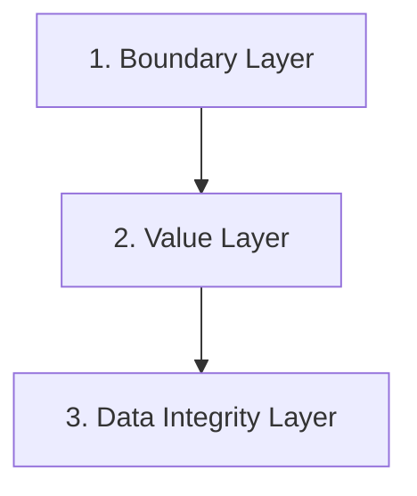

This chapter introduces the last execution primitive -- the **cardinality restriction** (**Exercise 26**) -- and then consolidates all five primitives into a single architecture.

**key Insight:**

> "A boundary tells the system what is permitted. A value tells the system what to act on. Cardinality tells the system *when it has enough to act*. Only all three together make execution safe."

## 26.2 Learning Objectives

After completing this chapter, you should be able to achieve the following learning outcomes:

**Knowledge:**

- Explain why data integrity is the third layer of an executable ontology
- Distinguish the three cardinality restrictions: `min`, `max`, and `exactly`
- Understand how cardinality differs from the closure and value layers
- Explain how the five execution primitives of Stage 7 form a single anatomy
- Trace the two historical lineages of executability: AI reasoning and industrial process
- Apply executable knowledge to industrial scenarios (manufacturing, compliance, process)

**Practical Skills:**

- Create cardinality restrictions (`min`, `max`, `exactly`) in Protégé
- Use `hasTopping min 3 PizzaTopping` and other cardinality patterns
- Convert a class using cardinality to a defined class
- Test cardinality-based classification by synchronizing the reasoner
- Verify that reasoner-inferred classifications match the intended integrity constraints

**Mathematical Perspective:**

- Understand cardinality as the bounded-extension restriction on a property
- Explain the relationship between cardinality, functional properties, and `hasValue`
- Understand how cardinality restrictions close the "number of values" dimension

**Engineering Perspective:**

- Understand data integrity as the *last* layer, not the first
- May the five Stage 7 primitives to the $\Theta/\Phi$ architecture
- Apply executable ontologies in industrial contexts

## 26.3 Exercise 26 -- Cardinality Restrictions and Data Completeness

Having established closure in **Exercise 23** and value binding in **Exercise 24 and 25**, we not turn to the final primitive of Stage 7: the **cardinality restriction.**.

This exercise follows the tutorial's **Exercise 26**, which introduces `InterestingPizza` -- a pizza with three or more toppings.

### 26.3.1 The Engineering Objectives

**Exercise 26** introduces the **Cardinality Restriction** -- a restriction on the *number* of values a property may have.

OWL provides three forms:

| Form | Meaning | Syntax |
| --- | --- | --- |
| **Minimum** | At least *n* values | `hasTopping min 3 PizzaTopping` |
| **Maximum** | At most *n* values | `hasTopping max 5 PizzaTopping` |
| **Exactly** | Exactly *n* values | `hasTopping exactly 2 PizzaTopping` |

A cardinality restriction for an "interesting pizza", for example, would be:

```text
Class: InterestingPizza
    EquivalentTo: Pizza and (hasTopping min 3 PizzaTopping)
```

This means: "An `InterestingPizza` is a `Pizza` with at least three toppings."

The engineering objective of **Exercise 26** is to demonstrate how cardinality restrictions **guarantee data completeness** -- the third and final requirement for **execution**.

Why does execution need cardinality?

Consider an execution rule that fires only when a pizza has enough toppings to qualify as "interesting". Without a cardinality restriction, the ontology cannot determine *how many* toppings the pizza has -- it can only say that *some* exist. A rule depends on count cannot fire reliably.

Cardinality closes the *number* dimension. Where the closure axiom closes the *set* of permitted toppings and `hasValue` closed the *specific value*, cardinality closes *how many* values the property may take.

**Key Insight:**

> "Cardinality is the last mile of executability. A rule that fires on 'at least three toppings' requires the ontology to know that count is enforced."

### 26.3.2 Implementation: Creating the Cardinality Restriction

Let's walk through the implementation step by step.

**Step 1: Open the `Pizza` ontology**

Open `pizza-ebook_ex25.rdf` in Protégé -- the file from the previous exercise, which now contains the enumerated class `Spiciness`, the `hasSpiciness` property, and the defined class `SpicyPizza`.

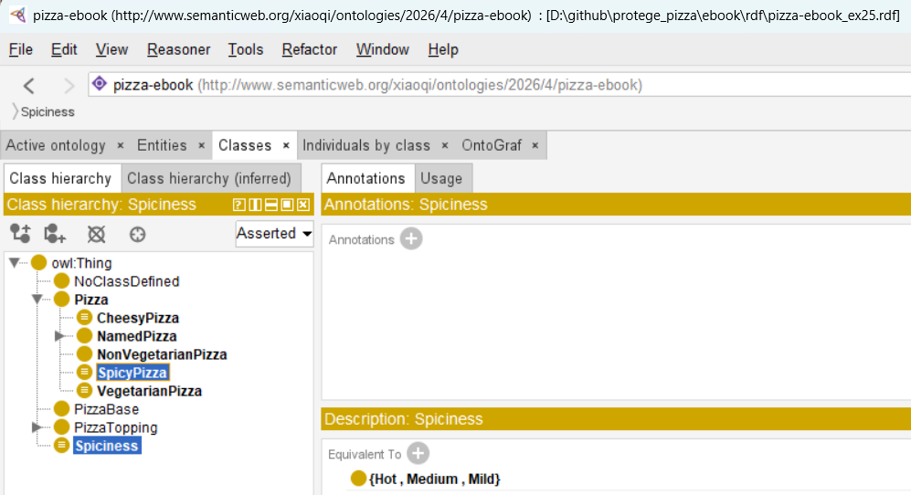

> [!Note]
> The finished state of **Exercise 26** will be saved as `pizza-ebook_ex26.rdf`.

**Step 2: Create the `InterestingPizza` class**

1. Make sure `Pizza` is selected in the class hierarchy
   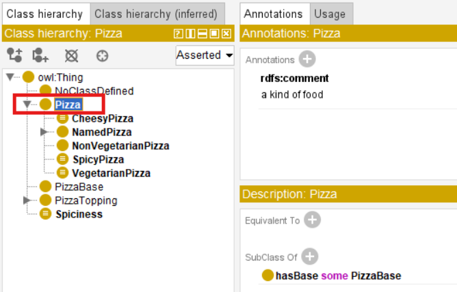
2. Click the **Add subclass** icon
   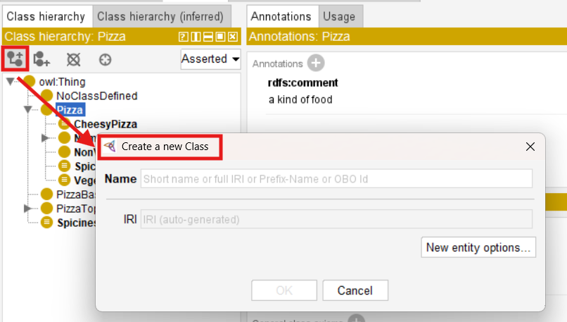
3. Name the new class `InterestingPizza`
4. 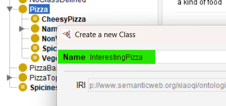
5. Click `OK`
   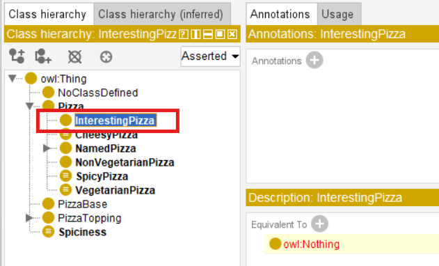

**Step 3: Add the cardinality restriction**

1. Select `InterestingPizza` (should already in focus after previous step)
2. In the Description view, locate the **SubClass Of** section
   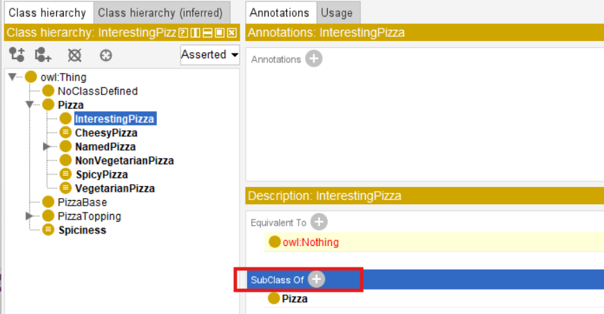
3. Click the Add icon (+)
   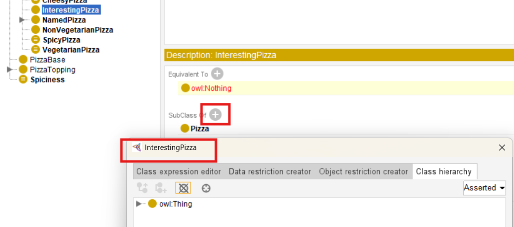
4. In the Class Expression Editor, enter: `hasTopping min 3 PizzaTopping`
   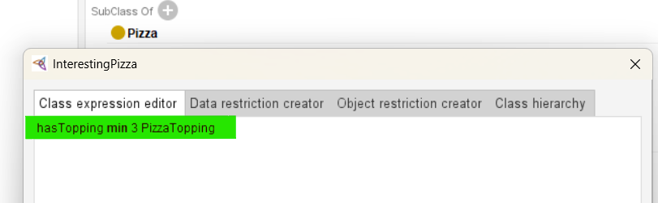
5. Click `OK`
   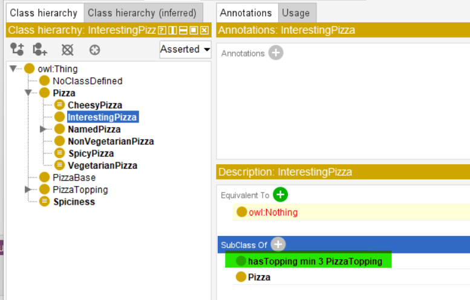

After this step, `InterestingPizza` has:

```text
Class: InterestingPizza
    SubClassOf: Pizza
    SubClassOf: hasTopping min 3 PizzaTopping
```

This says: "An `InterestingPizza` is a pizza and must have at least three toppings."

**Step 4: Convert `InterestingPizza` to a defined class**

1. Make sure `InterestingPizza` is still selected
2. Select `Edit > Convert to defined class`
   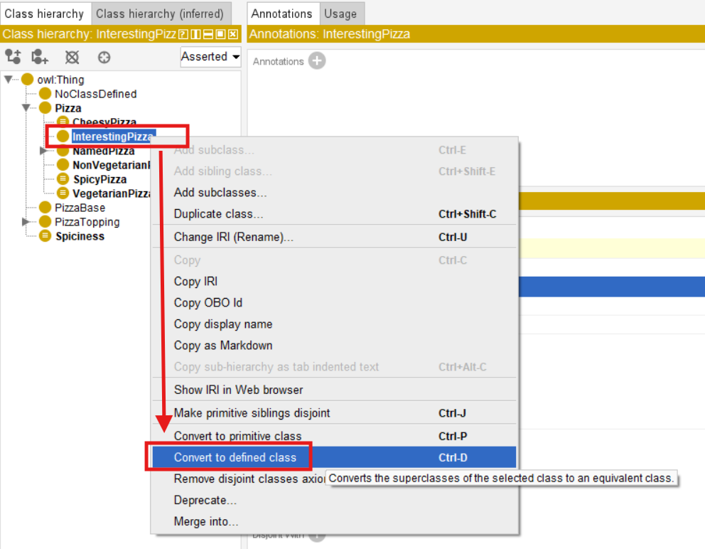

Observe what happens in the Description view. The `SubClassOf` axiom for the cardinality restriction is moved to `EquivalentTo`:

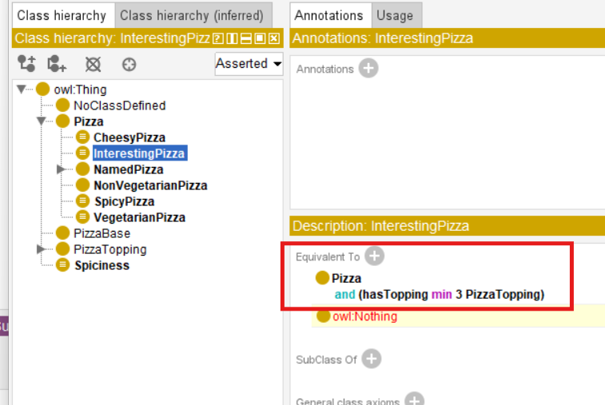

```text
Class: InterestingPizza
    EquivalentTo: Pizza and (hasTopping min 3 PizzaTopping)
    EquivalentTo: owl:Nothing
    SubClassOf: <Empty>
```

> [!Note]
> You may notice the **SubClass Of** section is empty, to learn why, check later §26.3.5 for some clarification.

**Step 5: Synchronize the reasoner**

Select `Reasoner > Synchronize reasoner` (Ctrl+R)

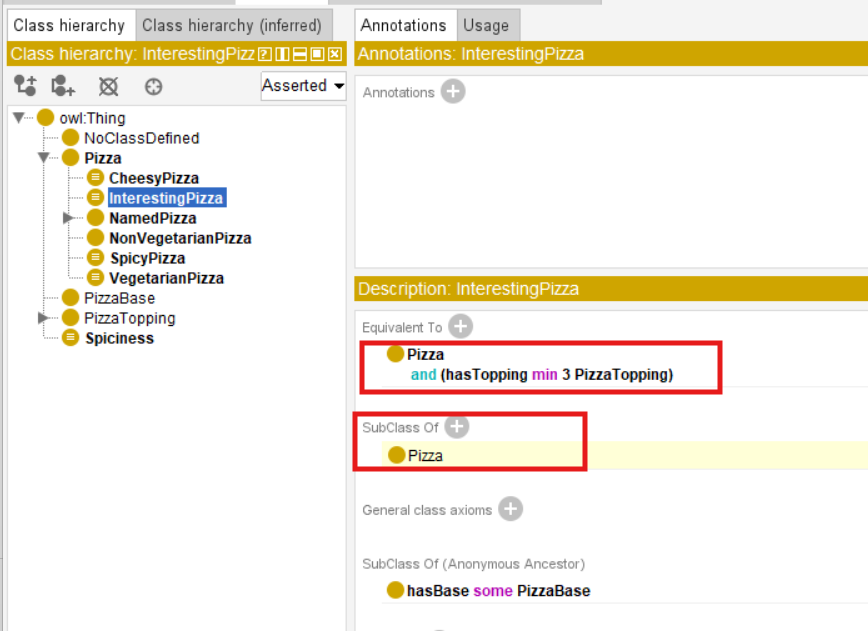

After reasoner synchronized, the **SubClass Of** section contains `Pizza` again.

```text
Class: InterestingPizza
    EquivalentTo: Pizza and (hasTopping min 3 PizzaTopping)
    SubClassOf: Pizza
```

**Step 6: Observe the result**

We would assume that the reasoner classifies pizzas with three or more toppings as subclasses of `InterestingPizza`. In the tutorial's data, these include `AmericanaHotPizza`, `AmericanaPizza`, and `SohoPizza`.

However, look at the **Class hierarchy (inferred)** tab:

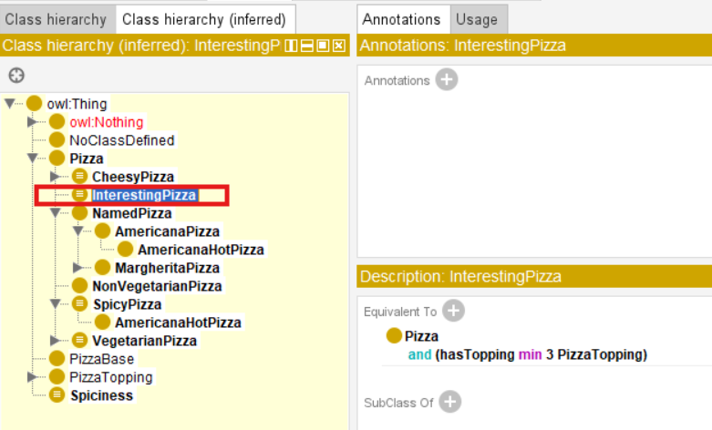

You will see something surprising: **Non of `AmericanaHotPizza`, `AmericanaPizza`, or `SohoPizza` are classified as subclasses of `InterestingPizza`.**

This is not as tutorial mentioned and unexpected. All three pizzas have three ot more toppings assertions:

| Pizza | Toppings |
| --- | --- |
| `AmericanaPizza` | Mozzarella, Pepperoni, Tomato (3) |
| `AmericanaHotPizza` | Mozzarella, Pepperoni, Tomato, Jalapeno (4) |
| `SohoPizza` | Mozzarella, Tomato, Olive, Parmesan (4) |

And yet the reasoner does not classify any of them under `InterestingPizza`.

No worry! This is not a bug in Protégé. It is a subtle consequence of how cardinality restrictions interact with existential restrictions under the Open World Assumption. It deserves its own explanation -- see **§26.3.3**.

### 26.3.3 Why the Reasoner Did Not Classify the Three Pizzas

The behavior in above Step 6 is one of the most instructive moments in this chapter. It looks like a failure, but it is a faithful reflection of OWL's semantics -- and understanding it is essential to writing executable ontologies that work in production.

**The apparent contradiction.** Each of the three pizzas has three or four existential toppings restrictions, e.g. `AmericanaPizza`:

```text
Class: AmericanaPizza
    SubClassOf: hasTopping some MozzarellaTopping
    SubClassOf: hasTopping some PepperoniTopping
    SubClassOf: hasTopping some TomatoTopping
```

A human reads this and concludes: "This pizza has three toppings." The `InterestingPizza` definition asks for `hasTopping min 3 PizzaTopping`. The count matches. So why doesn't the reasoner agree?

**The OWL semantics.** Existential restrictions do **not** commit to the number of distinct fillers. `hasTopping some X` means "there exists at least one value of `hasTopping` that is of type `x`." It does not say "there is exactly one" or "this is the only one of its kind." Under the Open World Assumption, the reasoner is forbidden from assuming the three existentials refer to three distinct individuals unless it can prove it from the axioms.

Even when the filler classers are declared disjoint -- as `MozzarellaTopping`, `PepperoniTopping`, and `TomatoTopping` are -- disjointness establishes that *if* three disjoint individuals exist, they are of different types. It does not establish that three individuals exist. The three existential restrictions could, in the reasoner's view, all be satisfied by the same single individual if that individual happened to be a member of all three classes. (In practice, disjointness rules that out here, but the reasoner cannot bridge from "there exist some X, some Y, some Z" to "there exist at least three individuals" without additional axioms.)

The `min 3 PizzaTopping` restriction, therefore, has nothing to count. The reasoner sees three *existential restrictions*, not three *toppings*, and it cannot satisfy the min-3 cardinality.

**Why this is important?** This is the single most common source of confusion when engineers first write cardinality restriction in OWL. It looks like the ontology should be able to count; semantically, it cannot, without more information. The tutorial's expectation that these pizzas would be inferred as `InterestingPizza` reflects human intuition about the data, not the reasoner's semantics.

This is not a flaw in OWL. It is a *design choice*: OWL refuses to commit to the number of values a property has unless the ontology explicitly closes the world. The consequence for execution is direct: **if a trigger depends on a count, the ontology must be engineered to that the count is provable.**

**Key Insight:**

> "The reasoner counts what the ontology proves, **not** what the engineer intends. Existential restrictions prove existence, not count. Only closure or explicit cardinality makes the count provable."

### 26.3.4 How to Make the Cardinality Fire

The fix is not to remove the cardinality restriction. The fix is to give the reasoner enough information to evaluate it. But as we are about to see, the "obvious" fix does not work -- and reason it does not work is one of the most important lessons in this chapter.

We will walk through the fix in stages. Each stage tries something, observes the result, and diagnoses why it did or did not work. This is what semantic engineering looks like in practice: **Not one big correct answer, but a disciplined sequence of hypotheses, tests, and corrections.**

#### Attempt 1 -- Add a closure axiom (the pattern from Chapter 24)

> [!Note] Keep `pizza-ebook_ex26.rdf` as one snapshot. From now on, the fix for Attempt 1 is saved in `pizza-ebook_ex26-approach1.rdf`

The natural first move is to apply the closure pattern from Chapter 24. If the reasoner cannot prove the count because it does not know the toppings are exhaustively the listed ones, then close the world for each pizza class using a universal restriction:

```text
Class: AmericanaPizza
    SubClassOf: hasTopping only (MozzarellaTopping or PepperoniTopping or TomatoTopping)
```

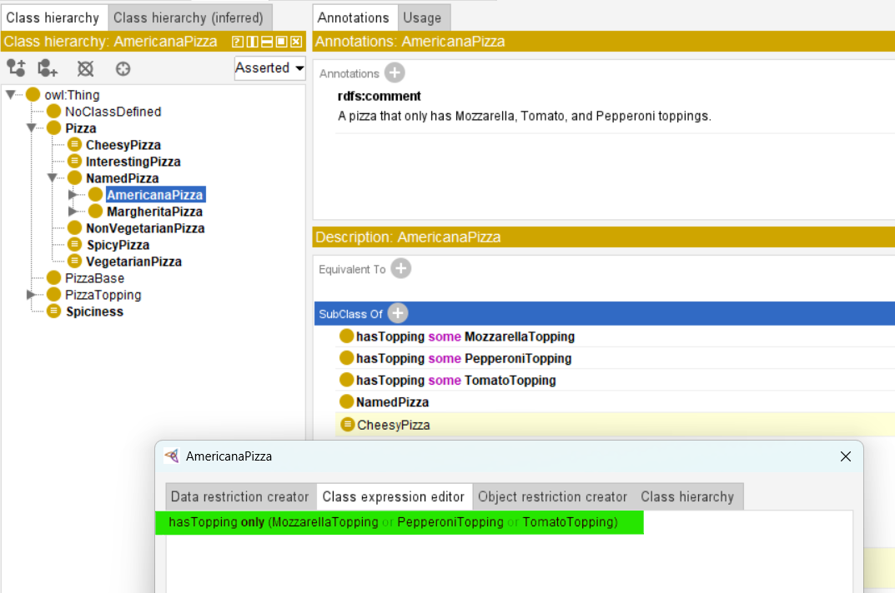

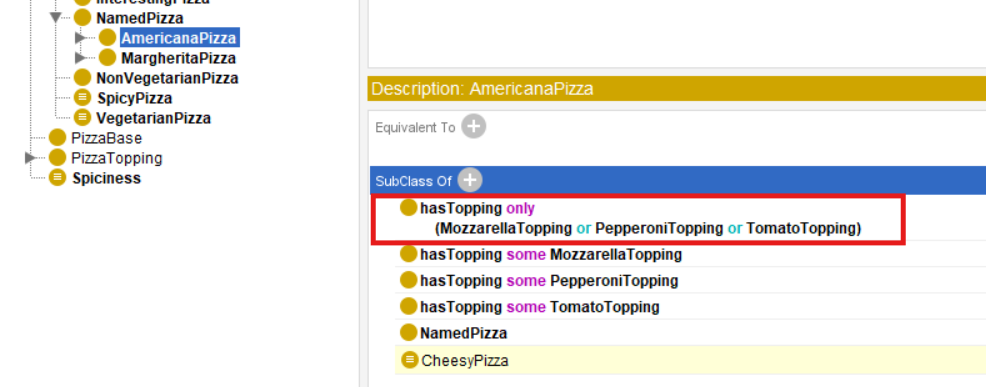

Apply the same closure to `AmericanaHotPizza` (Mozzarella, Pepperoni, Tomato, JalapenoPepper) and `SohoPizza` (Mozzarella, Tomato, Olive, Parmesan). This is exactly the pattern that worked in **Chapter 24** for `MargheritaPizza` and `SohoPizza`. It should work here too.

```text
Class: AmericanaPizza
    SubClassOf: hasTopping only (MozzarellaTopping or PepperoniTopping or TomatoPizza or JalapenoPepperTopping)
Class: SohoPizza
    SubClassOf: hasTopping only (MozzarellaTopping or TomatoTopping or OliveTopping or ParmesanTopping)
```

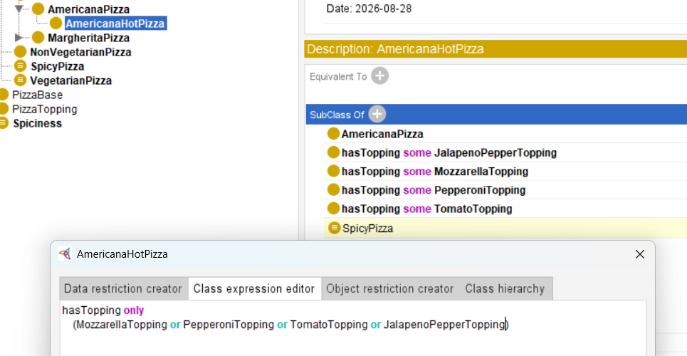

You may find `SohoPizza` has already had the needed universal restriction in the working ontology.

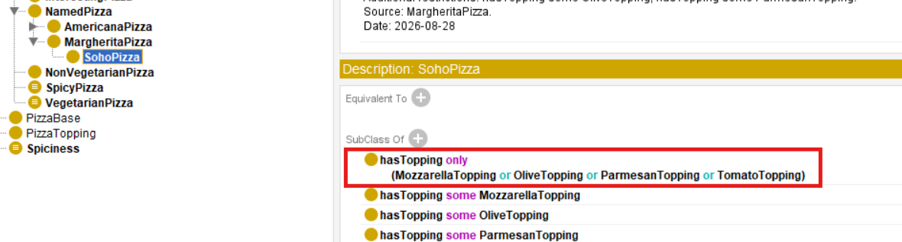

**Synchronize the reasoner and observe.** For `AmericanaPizza`, the result is **not** what we expect:

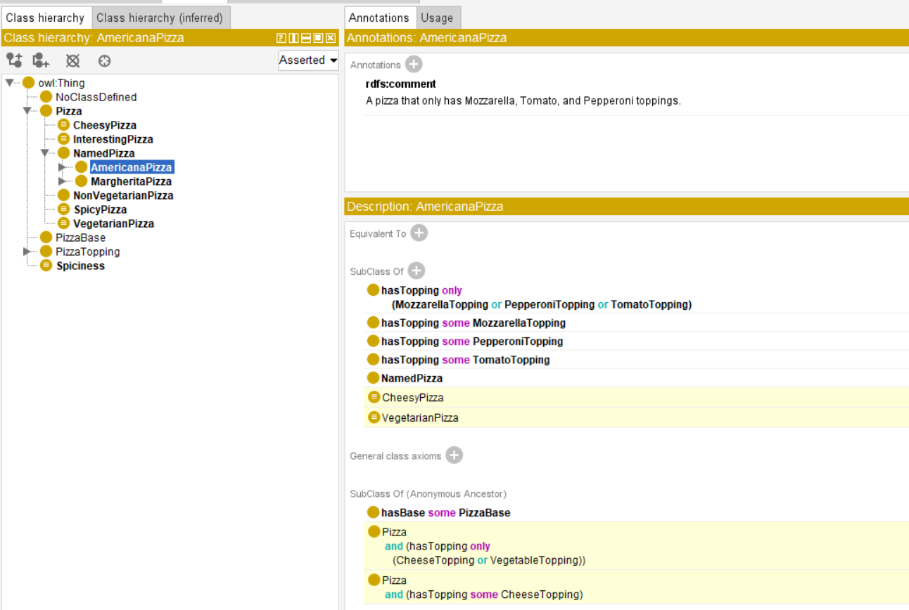

None of the three pizzas are classified as `InterestingPizza`. The closure axiom is in place -- we verified in the Protégé UI (the `hasTopping only (...)` restriction is visible in the `SubClass Of` section of `AmericanaPizza`) -- and yet the min-3 cardinality still does not fire.

**Attempt 1 has failed.** This is worth pausing on, because the failure is not a bug. It is a ***signal***.

**Why Attempt 1 failed -- and what the failure reveals?**

The closure axiom restricts the *range* of `hasTopping`: every topping must be in the listed union. This is necessary for the reasoner to bound the possible toppings. But for the min-3 cardinality to fire, the reasoner must still prove that **three distinct topping individuals exist**.

Even with the closure in place, the reasoner can prove at most **two** distinct toppings for `AmericanaPizza`, see from it's `SubClass Of` section below:

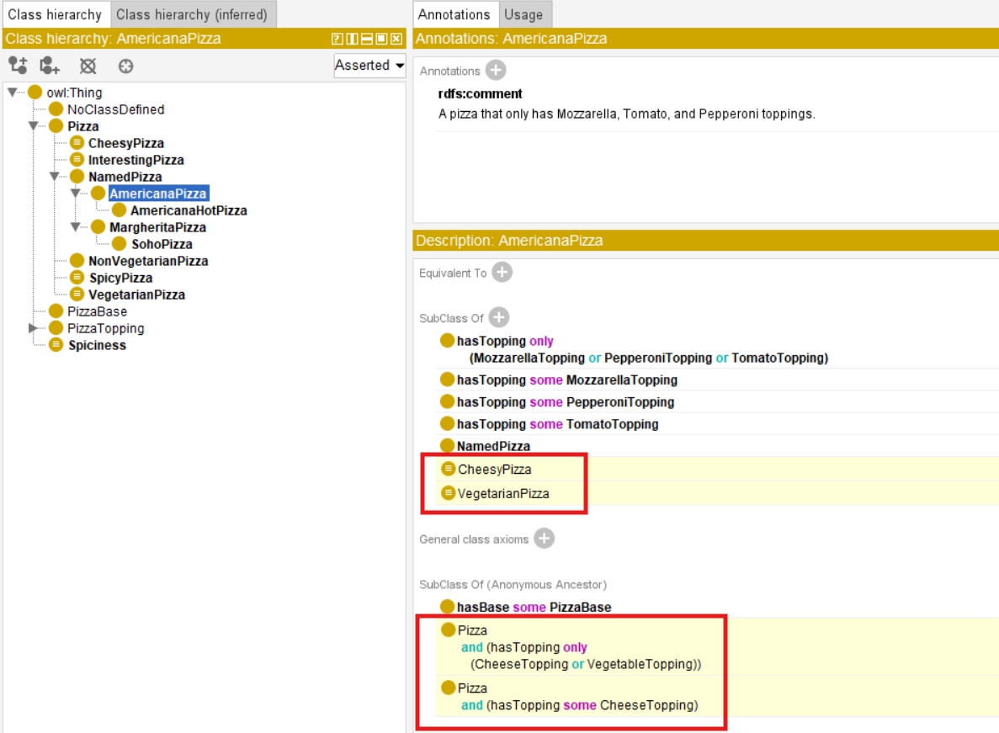

Here is why.

The reasoner's ability to count distinct individuals depends on being able to prove that two values cannot be the same individual. It proves this from **disjointness axioms**. If two classes `A` and `B` are declared disjoint, then no individual can be both an `A` and a `B`, so any individual of type `A` is distinct from any individual of type `B`.

For `AmericanaPizza`'s three toppings -- `MozzarellaTopping`, `PepperoniTopping`, `TomatoTopping` -- the reasoner needs to know that all three are pairwise disjoint. It checks the ontology:

- `MozzarellaTopping` is a subclass of `CheeseTopping`.
- `PepperoniTopping` is declared (in the working ontology) as a subclass of `VegetableTopping`.
- `TomatoTopping` is a subclass of `VegetableTopping`.

The ontology's disjointness declarations establish that `CheeseTopping`, `MeatTopping`, and `VegetableTopping` are pairwise disjoint. So:

- `MozzarellaTopping` (Cheese) is provably distinct from `PepperoniTopping` (Vegetable). :white_check_mark:
- `MozzarellaTopping` (Cheese) is provably distinct from `TomatoTopping` (Vegetable). :white_check_mark:
- `PepperoniTopping` (Vegetable) and `TomatoTopping` (Vegetable) are **not** declared disjoint from each other. :x:

The reasoner can prove at most **two** distinct toppings for `AmericanaPizza` -- Mozzarella is distinct from the others, but Pepperoni and Tomato might be the same individual as far as the reasoner can tell. The min-3 cardinality cannot be satisfied.

**But, wait, there is a deeper problem here.** The reason `PepperoniTopping` and `TomatoTopping` are not disjoint is not an accident of the ontology's design. It is a **modeling error**.

**Pepperoni is a meat product.** It should be subclass of `MeatTopping`, not `VegetableTopping`. The working ontology got this wrong. This is the same kind of error the SKDL was designed to catch -- but it has slipped through to Stage 7.

Let's verify the correct taxonomy. Michael DeBellis' reference ontology (`PizzaTutorialWithDataV2.owl`) declares:

```xml
<owl:Class rdf:about="...#PepperoniTopping">
    <rdfs:subClassOf rdf:resource="...#MeatTopping"/>
    ...
</owl:Class>
```

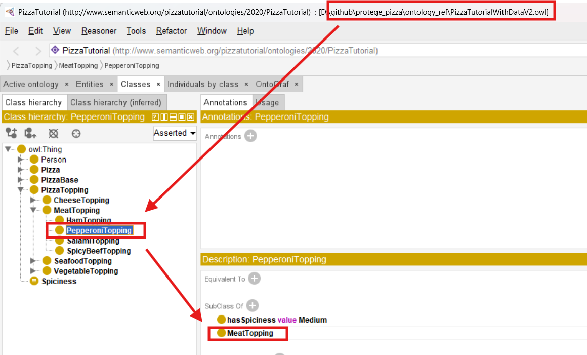

The reference is unambiguous: `PepperoniTopping` is a subclass of `MeatTopping`. The working ontology has it under `VegetableTopping`. **This is a Stage 1 modeling error.**

**Stage 7 cannot fix a Stage 1 error.**

This is the moment where the SKDL's discipline shows its value.

The SKDL is a **lifecycle**, not a checklist. Stage 7 (Executable Knowledge) depends on Stage 6 (Reasoning), which depends on Stage 5 (Validation), which depends on Stage 4 (Governance), which depends on Stage 3 (Reuse), which depends on Stage 2 (Description), which depends on Stage 1 (Conceptual Modeling).

If a modeling error exists at Stage 1, **no amount of engineering at Stage 7 will fix it**. The reasoner will faithfully compute the logical consequences of the axioms it is given -- including the axioms that encode the wrong taxonomy. Attempt 1 failed because the closure axiom's effect was undermined by a Stage 1 classification error that the closure could not compensate for.

**The honest engineering response is to go back to Stage 1, correct the model, and then re-run the Stage 7 work**.

#### Attempt 2 -- Correct the first Stage 1 modeling error, then re-test

The fix is a one-line change in the class hierarchy:

```text
Class: PepperoniTopping
    SubClassOf: MeatTopping     # was: VegetableTopping
```

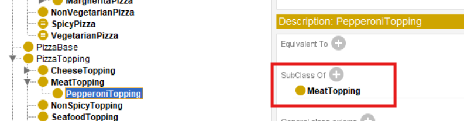

This moves `PepperoniTopping` out from under `VegetableTopping` and into its correct position under `MeatTopping`. Now `PepperoniTopping` is a subclass of `MeatTopping`, and `MeatTopping` is disjoint from `CheeseTopping` and `VegetableTopping` (per the ontology's `AllDisjointClasses` axioms).

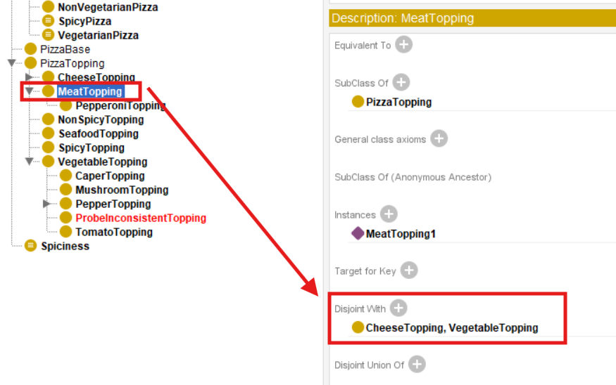

With this correction:

- `MozzarellaTopping` (Cheese) is provably distinct from `PepperoniTopping` (Meat). :white_check_mark:
- `MozzarellaTopping` (Cheese) is provably distinct from `TomatoTopping` (Vegetable). :white_check_mark:
- `PepperoniTopping` (Meat) is provably distinct from `TomatoTopping` (Vegetable). :white_check_mark:

All three of `AmericanaPizza`'s toppings are now provably pairwise distinct. The reasoner can count them. Combined with the closure axiom from Attempt 1, the min-3 cardinality should now fire for `AmericanaPizza`.

**Synchronize the reasoner and observe**. This time, the result of `AmericanaPizza` is what we expect:

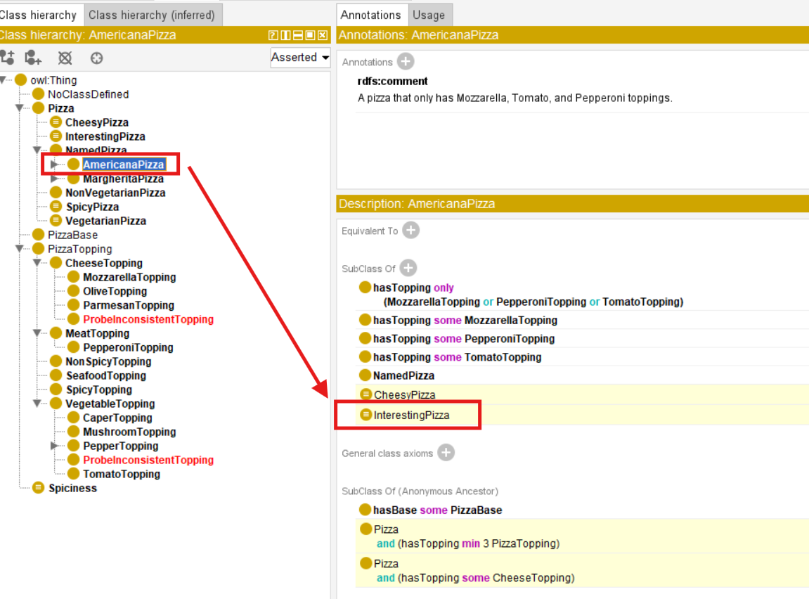

`AmericanaPizza` is now classified as subclass of `InterestingPizza`. **Good progress!** Its three toppings {Mozzarella, Pepperoni, Tomato} are pairwise provably distinct (Cheese $\perp$ Meat $\perp$ Vegetable), and the closure from Attempt 1 supplies the exhaustive count.

**However, `AmericanaHotPizza` and `SohoPizza` are still not classified**. Correcting one modeling error has fixed one pizza, but not the other two. The journey continues.

##### Attempt 2.1 -- Diagnose the remaining two pizzas

This is a **diagnostic** step. No new corrections are applied here. We investigate *why* the other two pizzas still fail.

**A preliminary tooling issue**

Before we trust the reasoner's output, there is one thing to check. The Protégé log shows:

```text
ERROR An error occurred during reasoning: A SWRL rule uses a built-in atom,
but built-in atoms are not supported yet.
java.lang.IllegalArgumentException: A SWRL rule uses a built-in atom,
but built-in atoms are not supported yet.
```

The active reasoner is **HermiT**, which does not support SWRL built-ins. The reference ontology contains two SWRL rules (`HotDiscountRule`, `LessSpicyCiscountRule`), both using `swrlb:greaterThan`. HermiT fails to load the ontology. Protégé falls backs to Pellet, but the reasoner state is unreliable.

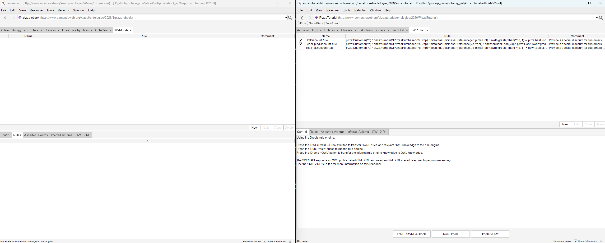

After comparing from above screenshot, the problem is not in the working ontology. The working ontology has no SWRL rules so far. The `A SWRL rule uses a built-in atom` error appeared only when the **reference ontology (`PizzaTutorialWithDataV2.owl`)** was open in a separate Protégé window during earlier work. In that session, HermiT refused to load the reference ontology, but the error is unrelated to the working ontology

The working ontology has no SWRL rules and no reasoner configuration issue. Pellet or HermiT both work.

> [!Note] Note 1: Not all reasoners support all features
> HermiT supports OWL 2 DL but not SWRL built-ins. Pellet supports both. When the ontology uses SWRL, select Pellet. Reading the reasoner log -- rather than guessing -- is a discipline that pays off repeatedly in ontology engineering.

> [!Note] Note 2: A note on multi-window Protégé sessions.
> When the working ontology and the reference ontology are open in separate Protégé windows, errors from one window can appear in the log of the other, causing confusion. The SWRL error above was from the reference ontology, not the working ontology. As a general practice, work with one ontology per Protégé session when diagnosing reasoner behavior. This avoids cross-contamination of logs and reasoner state.

**Why `AmericanaHotPizza`** still fails

`AmericanaHotPizza` has four toppings: Mozzarella, Pepperoni, Tomato, JalapenoPepper.

> [!Note] Not include `Topping` postfix for simplified displaying purpose only.

After the Pepperoni fix (Correction 1), the disjointness checks are:

- Mozzarella (Cheese) vs. Pepperoni (Meat) :white_check_mark:
- Mozzarella (Cheese) vs. Tomato (Vegetable) :white_check_mark:
- Mozzarella (Cheese) vs. JalapenoPepper (Vegetable > Pepper) :white_check_mark:
- Pepperoni (Meat) vs. Tomato (Vegetable) :white_check_mark:
- Pepperoni (Meat) vs. JalapenoPepper (Vegetable > Pepper) :white_check_mark:
- **Tomato (Vegetable) vs. JalapenoPepper (Vegetable > Pepper) :x:**

Both `TomatoTopping` and `JalapenoPepperTopping` sit under `VegetableTopping`. The working ontology declares only the three pepper subclasses (`GreenPepper`, `JalapenoPepper`, and `RedPepper`) as pairwise disjoint.

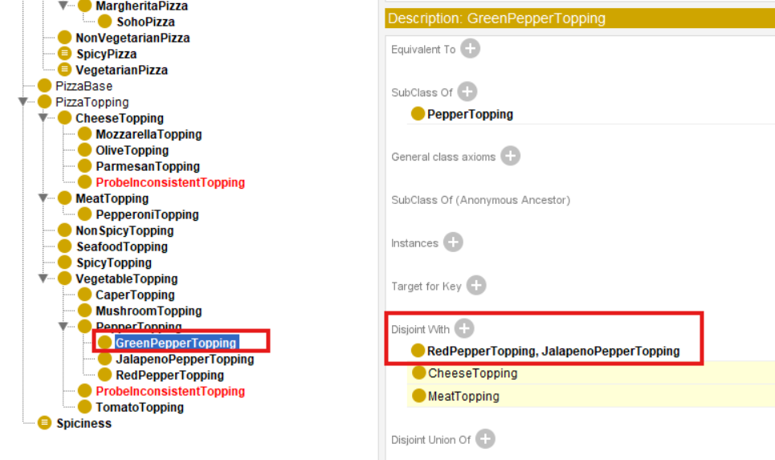

It does **not** declare the broader vegetable subclasses (`Caper`, `Mushroom`, `Pepper`, `Tomato`) as disjoint.

> [!Note] You may still see that `ProbeInconsistentTopping` as subclass of `VegetableTopping`, leave it as that's not impact this fixing result.

The reference ontology has this broader declaration for `VegetableTopping`:

```xml
<owl:members rdf:parseType="Collection">
    <rdf:Description rdf:about="...#CaperTopping"/>
    <rdf:Description rdf:about="...#MushroomTopping"/>
    <rdf:Description rdf:about="...#OliveTopping"/>
    <rdf:Description rdf:about="...#PepperTopping"/>
    <rdf:Description rdf:about="...#TomatoTopping"/>
</owl:members>
```

> [!Note] The working ontology doesn't have `OliveTopping` as a subclass of `VegetableTopping` so far, which is mentioned below as another modeling difference.

| Working Ontology | Reference Ontology |
| --- | --- |
| 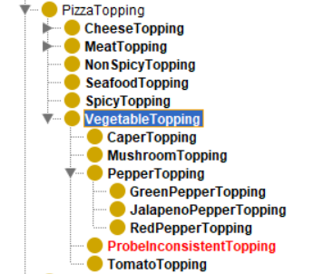 | 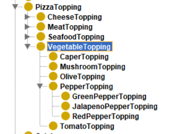 |

The working ontology is **missing this broader disjointness declaration**, also `OliveTopping` is wrongly modeled as a subclass of `CheeseTopping` while should be a subclass of `VegetableTopping`. Without the correct modeling and proper broader disjointness declaration, the reasoner cannot prove that Tomato and JalapenoPepper are disjoint.

> [!Note] You may still see `ProbeInconsistentTopping` as a subclass of `VegetableTopping`. Leave it -- it does not impact this fixing result.

**Why `SohoPizza` still fails**

`SohoPizza` also has four toppings: Mozzarella, Olive, Parmesan, Tomato. Two problems, of different kinds.

**Problem 1 -- a modeling error in the topping taxonomy.** In the working ontology, as found in above `AmericanaHotPizza` analysis, `OliveTopping` is declared as a subclass of `CheeseTopping`:

```xml
<owl:Class rdf:about="...#OliveTopping">
    <rdfs:subClassOf rdf:resource="...#CheeseTopping"/>
</owl:class>
```

But Olive is not a cheese. In the reference ontology, `OliveTopping` is a subclass of `VegetableTopping` (see table above). **This is a second Stage 1 modeling error.**

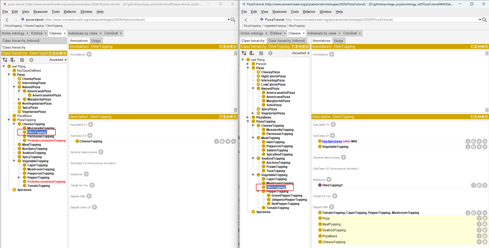

With Olive misplaced under Cheese, `SohoPizza`'s toppings become: Mozzarella (Cheese), Tomato (Vegetable), Olive (Cheese), Parmesan (Cheese). The reasoner checks:

- Mozzarella (Cheese) vs. Tomato (Vegetable) :white_check_mark:
- Mozzarella (Cheese) vs. Olive (Cheese) -- both cheese, no disjointness declared :x:
- Mozzarella (Cheese) vs. Parmesan (Cheese) -- both cheese, no disjointness declared :x:
- Olive (Cheese) vs. Parmesan (Cheese) :x:
- Tomato (Vegetable) vs. all cheeses :white_check_mark:

The reasoner can prove at most **two** distinct toppings for `SohoPizza`. The min-3 fails.

**Problem 2 -- a closure-inheritance conflict.** `SohoPizza` is declared as s subclass of `MargheritaPizza`:

```xml
<owl:Class rdf:about:"...#SohoPizza">
    <rdfs:subClassOf rdf:resource="...#MargheritaPizza"/>
    ...
</owl:Class>
```

And, in working ontology, `MargheritaPizza` carries a closure axiom from Chapter 24:

```text
Class: MargheritaPizza
    SubClassOf: hasTopping only (MozzarellaTopping or TomatoTopping)
```

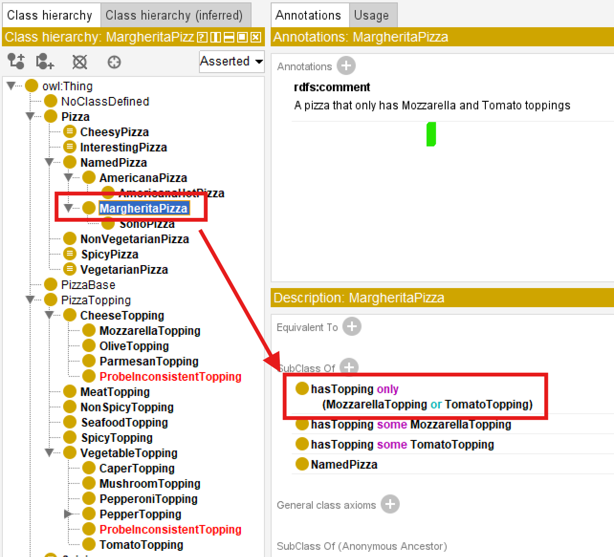

This closure, due to `SohoPizza` $\sqsubseteq$ `MargheritaPizza`, restricts every `MargheritaPizza`'s toppings to {Mozzarella, Tomato}. `SohoPizza` inherits this. But `SohoPizza` also has `hasTopping some OliveTopping` and `hasTopping some ParmesanTopping`, requiring at least one of each. Neither Olive nor Parmesan is in the inherited union.

The two axioms cannot both be satisfied. The reasoner correctly infers `SohoPizza` to be `owl:Nothing` -- an unsatisfiable class.

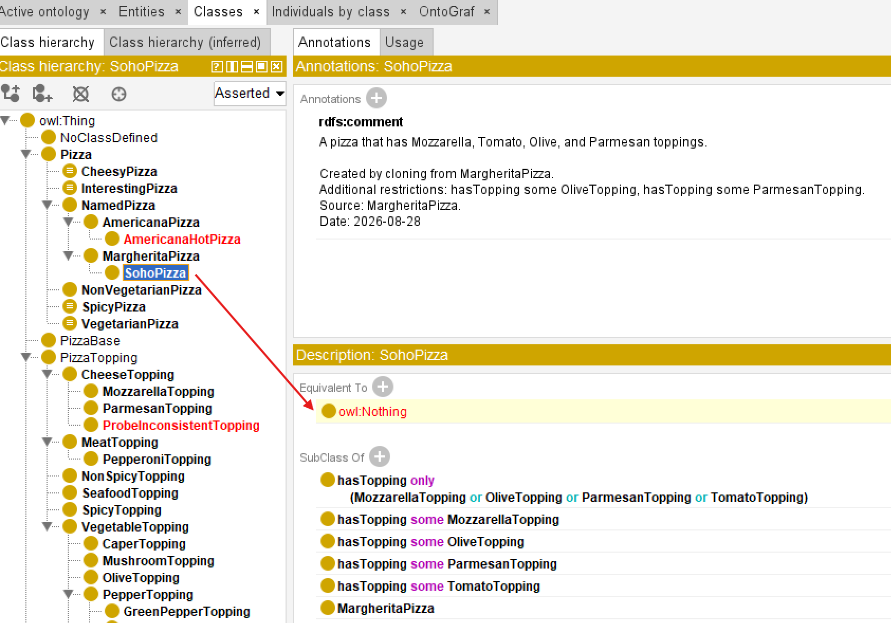

**The same closure-inheritance conflict affects `AmericanaHotPizza`.**  `AmericanaHotPizza` is declared as a subclass of `AmericanaPIzza`, which carries a closure to {Mozzarella, Pepperoni, Tomato}. `AmericanaHotPizza` adds `hasTopping some JalapenoPepperTopping`. Jalapeno is not in the inherited union. `AmericanaHotPizza` is also inferred to be `owl:Nothing`.

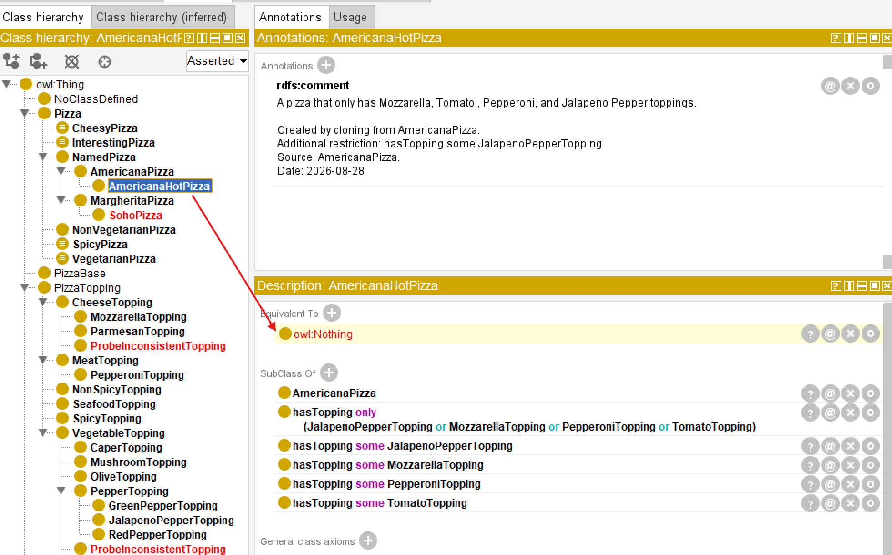

**Summary of Attempt 2.1**

We now know:

- `AmericanaPizza` was fixed in Attempt 2 (Correction 1).
- `AmericanaHotPizza` needs the broad vegetable disjointness (Correction 3) **and** a resolution of the closure-inheritance conflict (Corrections 4-6).
- `SohoPizza` needs the Olive reclassification (Correction 2), the broad vegetable disjointness (Correction 3), **and** a resolution of the closure-inheritance conflict (Corrections 4-6).
- The reasoner must be switched to use Pellet.

No fix is applied in this step. Attempt 2.2 applies them.

##### Attempt 2.2 -- Apply the remaining corrections and re-test

The complete set of corrections, with the order in which they will be applied:

| # | Correction | Type | Applied in |
| --- | --- | --- | --- |
| 1 | `PepperoniTopping` $\sqsubseteq$ `MeatTopping` (was `VegetableTopping`) | Taxonomy | Attempt 2 |
| 2 | `OliveTopping` $\sqsubseteq$ `VegetableTopping` (was `CheeseTopping`) | Taxonomy | Attempt 2.2 |
| 3 | `DisjointClasses: Caper, Mushroom, Olive, Pepper, Tomato` | Disjointness | Attempt 2.2 |
| 4 | `SohoPizza` $\sqsubseteq$ `NamedPizza` (was `MargheritaPizza`) | Hierarchy | Attempt 2.2 |
| 5 | Remove closure from `AmericanaPizza` | Closure | Attempt 2.2 |
| 6 | Introduce `PlainAmericanaPizza` with closure {M, P, T} | Structure | Attempt 2.2 |

**Correction 2 -- Move `OliveTopping` to `VegetableTopping`**

```text
Class: OliveTopping
    SubClassOf: VegetableTopping    # was: CheeseTopping
```

| Before Fixing | After Fixing |
| --- | --- |
| 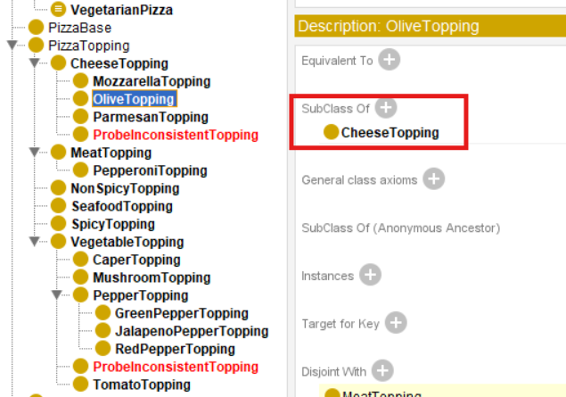 | 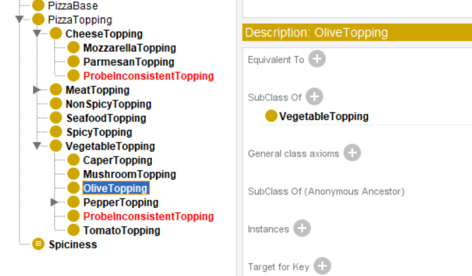 |

After this correction, synchronizing the reasoner. `AmericanaHotPizza` and `SohoPizza` **still do not classify**:

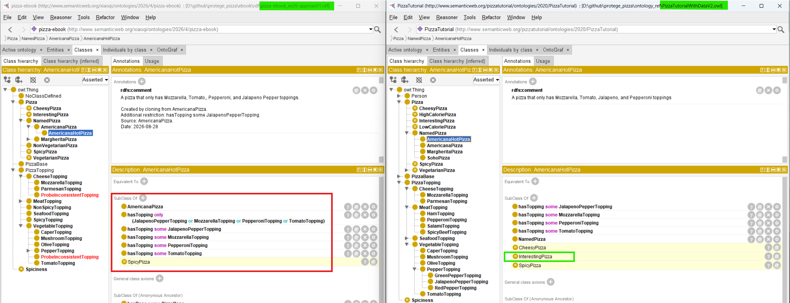

The fixing is not completed. This is expected -- the closure-inheritance conflict remains, and the broader disjointness is still missing.

**Correction 3: Add the broad vegetable disjointness declaration**

```text
DisjointClasses: CaperTopping, MushroomTopping, OliveTopping, PepperTopping, TomatoTopping
```

The reference ontology shows this kind of broad vegetable disjointness:

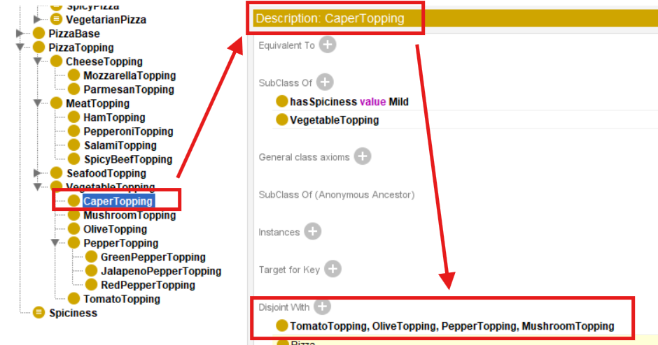

| Before adding broad Disjointness | After adding broad Disjointness |
| --- | --- |
| 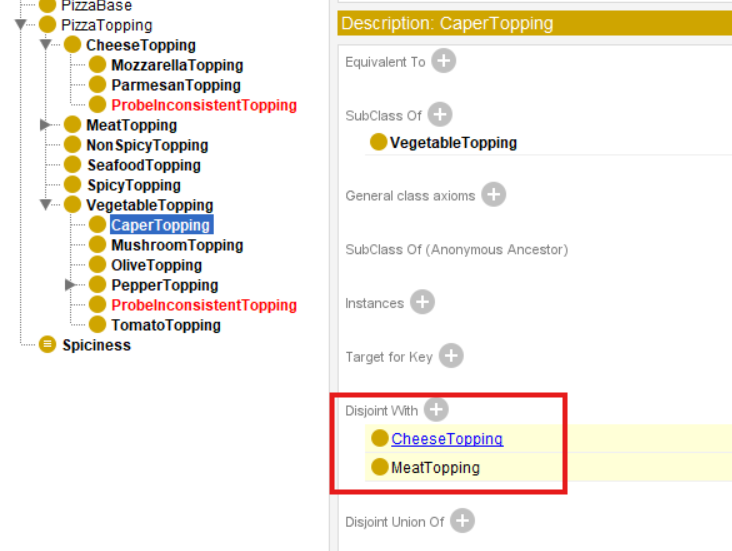 | 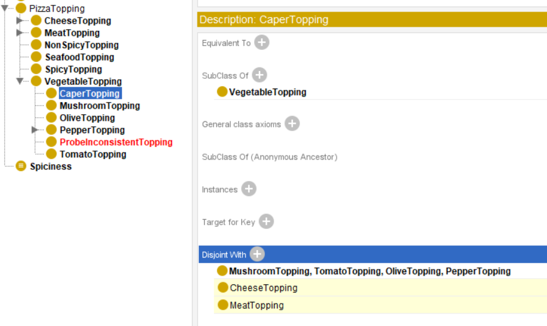 |

After this correction, synchronize the reasoner again. Still, `AmericanaHotPizza` and `SohoPizza` do not classify. **The disjointness was not the only blocker.** The remaining blocker is the closure-inheritance conflict.

**Diagnosing the closure-inheritance conflict**

Let us name the pattern we have discovered, because it is general:

> **A closure axiom on a parent class propagates to every subclass. If any subclass extends the parent's topping set, the inherited closure contradicts the subclass' own restrictions, and the subclass becomes unsatisfiable (`owl:nothing`).**

Both branches of our pizza hierarchy exhibit this conflict:

- **Americana branch**: `AmericanaPizza` has closure {M, P, T}; `AmericanaHotPizza` extends it with Jalapeno. **Conflict.**
- **Margherita branch**: `MargheritaPizza` has closure {M, T} (added in Chapter 24); `SohoPizza` extends it with Olive and Parmesan. **Conflict.**

The reference ontology avoids this by **flattening the structure** -- all four named pizzas are siblings under `NamedPizza`. Our working ontology uses a richer, hierarchical structure, which is a legitimate modeling choice -- an Americana Hot Pizza *is a kind of* Americana Pizza with jalapeño added. But the hierarchy forces us to resolve the closure-inheritance conflict correctly.

There are four candidate fixes.

**Option A -- Flatten the structure**

Move `AmericanaHotPizza` and `SohoPizza` to be direct subclasses of `NamedPizza`, matching the reference ontology.

- *Pros*: Simple, known to work, no new classes.
- *Cons*: Loses the "is a kind of" semantic relationship.

**Option B -- Widen the parent's closure to include the subclass's toppings**

Change `AmericanaPizza`'s closure to include Jalapeno:

```text
Class: AmericanaPizza
    SubClassOf: hasTopping only (MozzarellaTopping or PepperoniTopping or TomatoTopping or JalapenoPepperTopping)
```

- *Pros*: Keeps the hierarchy. Small textual change.
- *Cons*: **This is semantically wrong.** A closure axiom is a universal restriction -- `hasTopping only X` says *for every value v of hasTopping, v $\in$ X*. Widening the parent's closure to include Jalapeno says "every Americana Pizza may have a Jalapeno topping." But a plain Americana Pizza does not have jalapeño. We have leaked the subclass's extension into the parent's definition. The parent's closure no longer describes the parent; it describes the union of all descendants. The axiom loses its semantic precision.

**We reject Option B.** It resolves the reasoner's complaint by weakening the semantics of the parent.

**Option C -- Introduce "plain" leaf classes that carry the closures**

Keep the hierarchy, but remove the closure from the parent. Introduce a leaf class representing "plain Americana Pizzas with exactly the standard three toppings":

```text
Class: PlainAmericanaPizza
    SubClassOf: AmericanaPizza
    SubClassOf: hasTopping only (MozzarellaTopping or PepperoniTopping or TomatoTopping)
```

Closures now live only on the leaves. **No inheritance conflict.**

- *Pros*: Semantically clean. This is the well-known **two-tier** or **definition/closure separation** pattern.
- *Cons*: Introduces new classes. Existing instances would need to be reclassified.

**Option D -- Hybrid: keep inheritance where it does not conflict; revert to flat where it does**

Observe that the two branches have different historical constraints. `MargheritaPizza`'s closure was placed in Chapter 24 for the `VegetarianPizza` classification -- it is used elsewhere in the book. `AmericanaPizza`'s closure was placed in Attempt 1 of this exercise.

The pragmatic hybrid:

- **Americana branch:** keep the hierarchy, introduce `PlainAmericanaPizza` for the closure. This is Option C applied to one branch.
- **Margherita branch:** match the reference. Move `SohoPizza` to be a direct subclass of `NamedPizza`. This preserves Chapter 24's `MargheritaPizza` closure and its `VegetarianPIzza` classification.

The result is asymmetric -- and that asymmetry is honest. It reflects the specific interactions between closures, inheritance, and the chapters already written.

**Applying the hybrid fix (Option D)**

> [!Note] In `rdf` folder, I've saved previous `approach1` ontology to a new file named as `pizza-ebook_ex26-approach1-attempt2.2.rdf`, which you can use for practicing below corrections.

**Correction 4 -- Move `SohoPizza` to `NamedPizza`**

```text
Class: SohoPizza
    SubClassOf: NamedPizza      # was: MargheritaPizza
```

| Before | After |
| --- | --- |
| 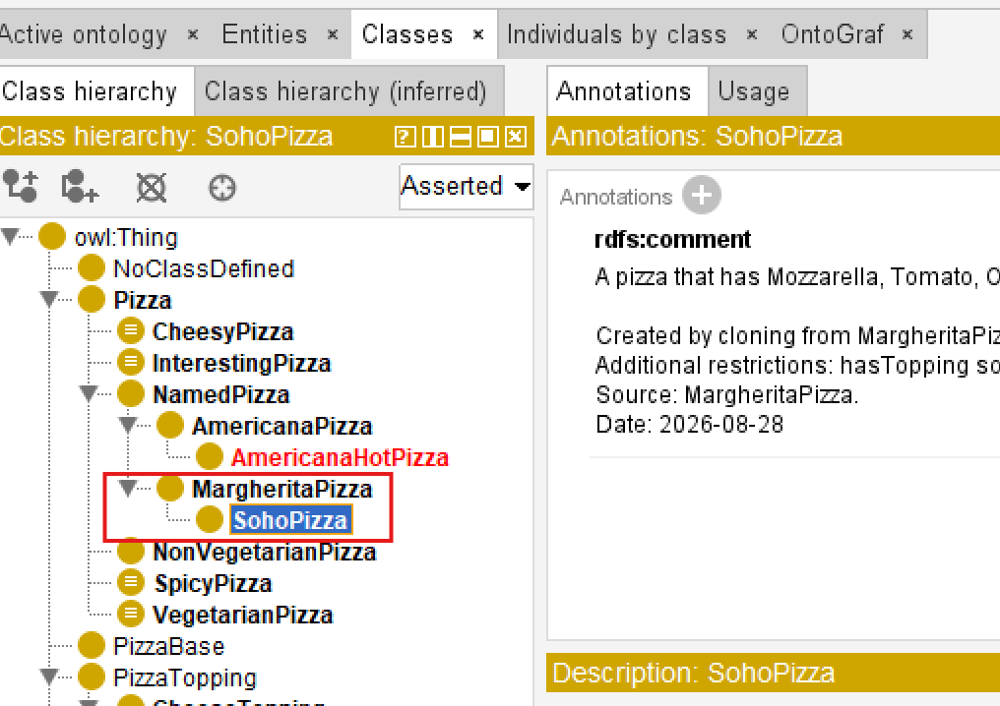 | 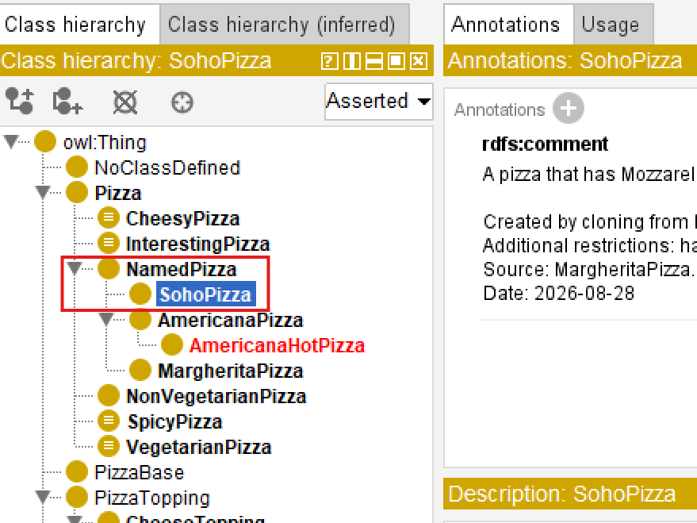 |

`SohoPizza` no longer inherits `MargheritaPizza`'s closure. Its own closure to {Mozzarella, Tomato, Olive, Parmesan} is the only closure that applies to it, and it is sound. `MargheritaPizza` retains its Chapter 24 closure -- no conflict, because it now has no subclass that extends its topping set.

**Synchronize the reasoner and observe**

`SohoPizza` (M, T + O + Pa): three provably distinct (M, T, O via the vegetable disjointness). :white_check_mark:

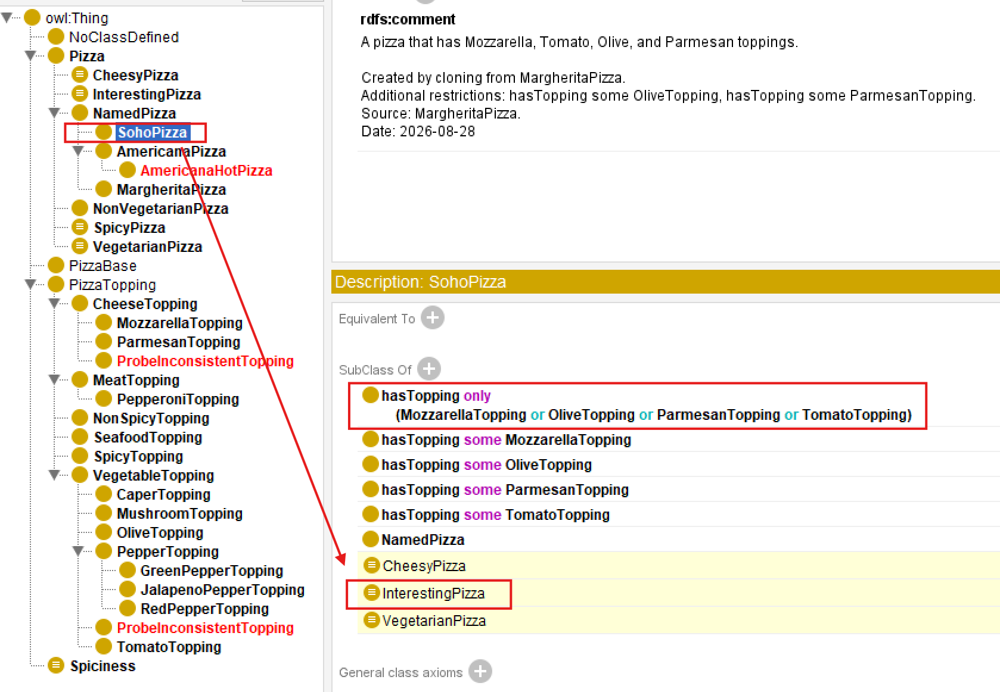

`MargheritaPizza` (M, T): two toppings -- correctly **not** classified as `InterestingPizza`.

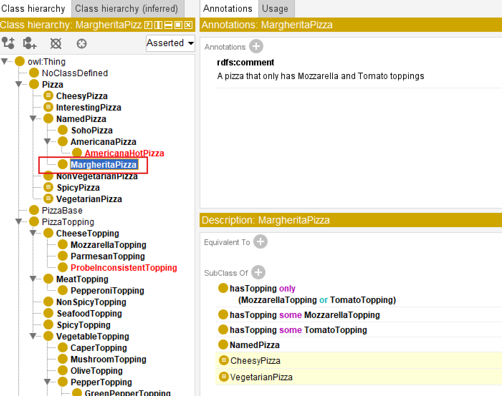

**Correction 5 -- Remove the closure from `AmericanaPizza`**

```text
Class: AmericanaPizza
    SubClassOf: NamedPizza
    SubClassOf: hasTopping some MozzarellaTopping
    SubClassOf: hasTopping some PepperoniTopping
    SubClassOf: hasTopping some TomatoTopping
    # closure removed
```

Before Correction 5:

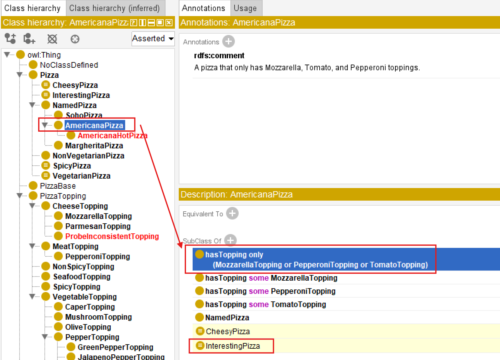

After Correction 5:

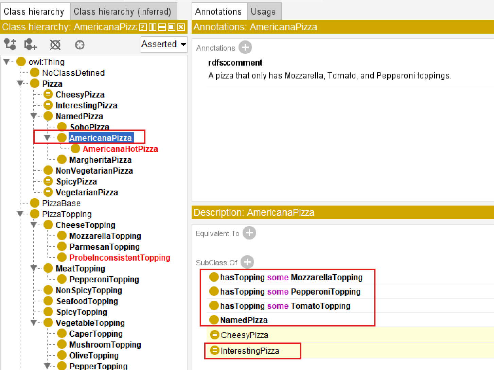

**Synchronize the reasoner and observe**

`AmericanaPizza` is still classified as subclass of `InterestingPizza`, since it fulfills the 3 distinct toppings criteria; and you may notice the inconsistency (red color) on `AmericanaHotPizza` has disappeared, means there's no axiom inheritance conflicts after this correction.

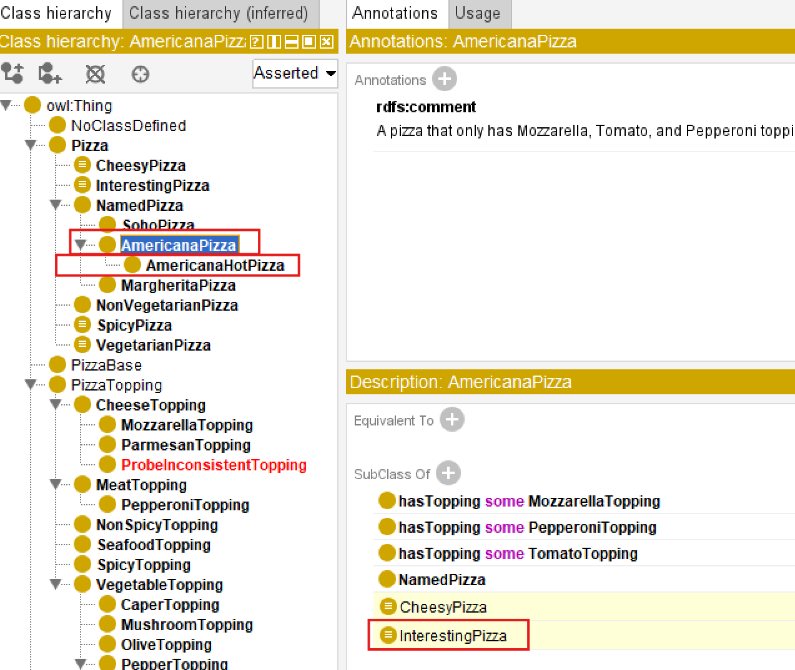

However, `AmericanaHotPizza` is still not classified as subclass of `InterestingPizza`:

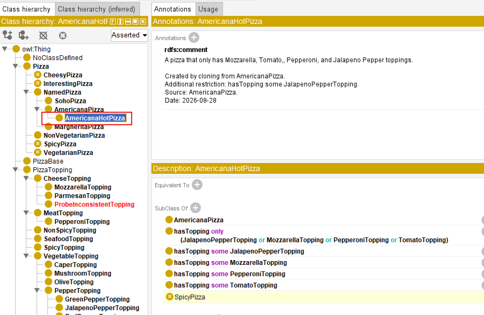

**Correction 6 -- Introduce `PlainAmericanaPizza` with the closure**

```text
Class: PlainAmericanaPizza
    SubClassOf: AmericanaPizza
    SubClassOf: hasTopping only (MozzarellaTopping or PepperoniTopping or TomatoTopping)
```

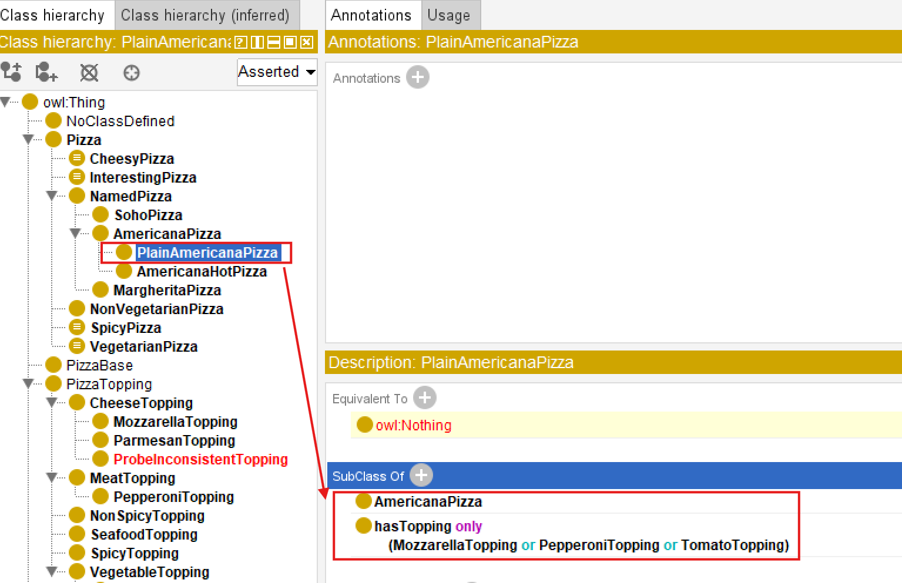

The closure now lives on the leaf. `AmericanaHotPizza` keeps its own closure to {M, P, T, J}. Neither conflicts with the other.

**Synchronize the reasoner and observe**

- `AmericanaPizza`, no closure: classified as subclass of `InterestingPizza`. :white_check_mark:
- `PlainAmericanaPizza (M, P, T): three provably distinct toppings. :x:
  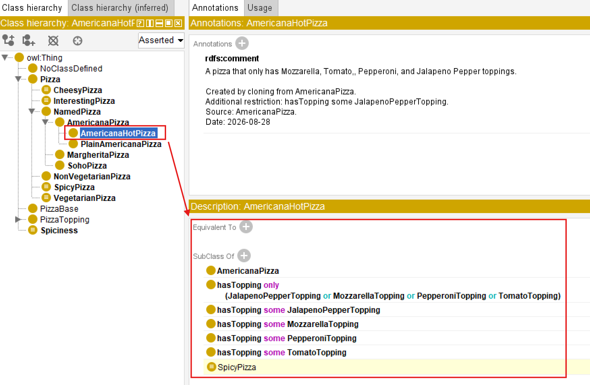
- `AmericanaHotPizza (M, P, T + J): four provably distinct toppings. :x:
  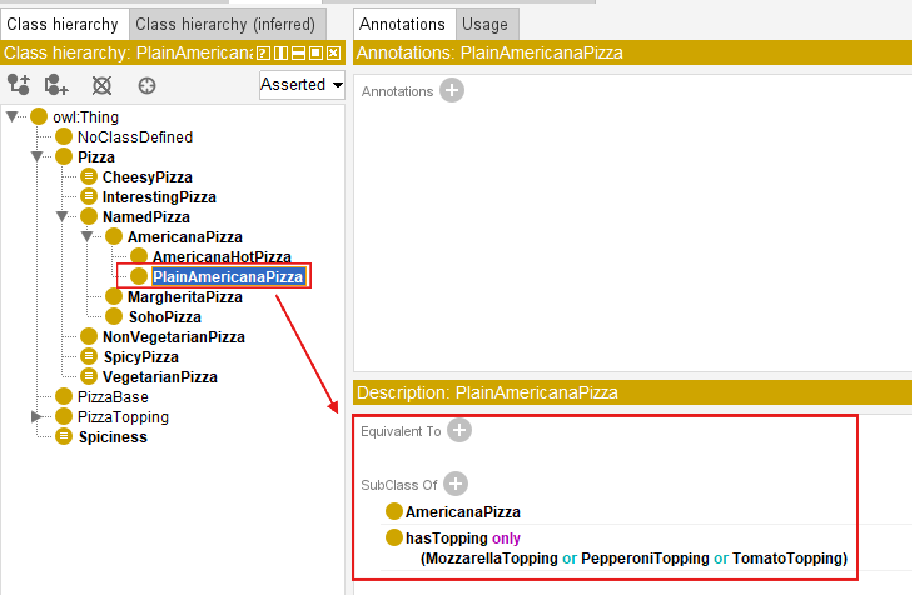

After applying all six corrections, `AmericanaPizza` and `SohoPizza` classify correctly. However, `PlainAmericanaPizza` and `AmericanaHotPizza` do not, despite having logically correct axioms.

##### Attempt 2.3 -- Investigate the remaining two classes

Two steps:

1. **Workspace hygiene.** Confirm that only the working ontology is open. Confirm no SWRL rules exist. Confirm the reasoner is Pellet or HermiT (both work for this ontology).
2. **Restart and re-synchronize.** Clear the reasoner cache by restarting Protégé.

Below Task Manager in Windows shows no `Protégé` process (except VS Code is used to editing this book) exists:


However, after the clean restart both reasoners agree the classes still do not classify.

##### Attempt 2.4 -- Investigate the apparent non-classification

After applying Corrections 1-6, `AmericanaPizza` and `SohoPizza` appear to classify correctly -- their inferred position in the tree is under `InterestingPizza`. `AmericanaHotPizza` and `PlainAmericanaPizza` appear **not** to classify, because their Description panels do not show `InterestingPizza` in the `SubClass Of` field.

Before assuming a reasoner failure, verify by switching to the **Class hierarchy (inferred)** tab and inspecting the class hierarchy around `InterestingPizza`.

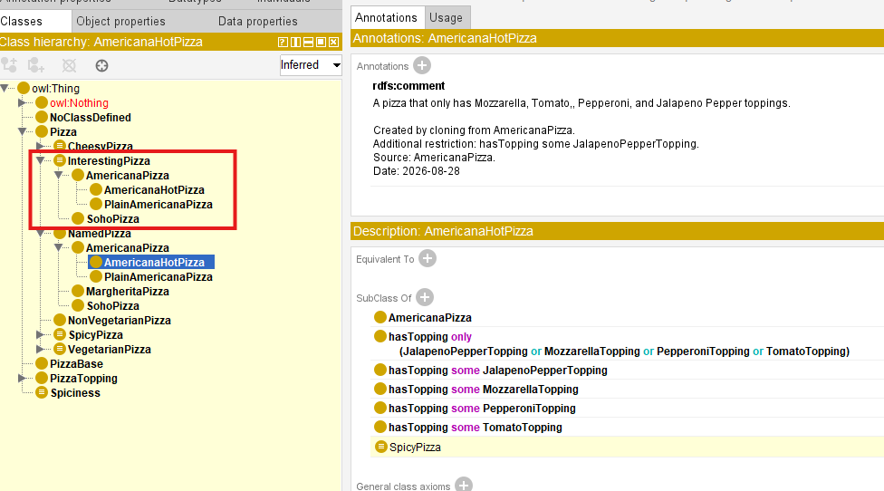

The inferred tree shows `InterestingPizza` with **all four of the target pizzas nested under it**: `AmericanaPizza`, `AmericanaHotPizza`, `PlainAmericanaPizza`, and `SohoPizza`. The reasoner **has** inferred the classification.

**The apparent failure was a Protégé UI display artifact.** When the reasoner infers $\text{A} \sqsubseteq \text{C}$ transitively (through $\text{A} \sqsubseteq \text{B} \sqsubseteq \text{C}$), Protégé's **inferred class hierarchy tree** shows `A` under `C`, but the **Description panel** for `A` may not show `C` in the `SubClass Of` field. This is because the Description panel displays asserted axioms and directly inferred axioms, not all transitive entailments.

To verify an inferred ancestor, use one of:

- The **inferred class hierarchy tree** (authoritative global view).
- The **DL Query** tab -- query for the candidate superclass, check "Subclasses".
- Select the **candidate superclass** in the tree and inspect its inferred children.

Here, from the 2nd verification method:

1. Use the `DL Query` tab
2. Enter the query: `InterestingPizza`
3. Check the `Instances` and `Subclasses` boxes.
4. The result should list the four pizzas.


**The full correction set worked.** All four pizzas with three or more toppings classify as `InterestingPizza`. `MargheritaPizza` with 2 toppings correctly does not.

##### The lesson: verify inference in the right view

When working with reasoner-inferred classifications in Protégé, always verify in the **inferred class hierarchy tree**, not in the Description panel. The Description panel tells you what the class *has been asserted to be*. The inferred tree tells you what the reasoner has *derived*. These are different views, and Protégé does not always surface every inference in the Description panel.

> [!Note] A Protégé UI behavior
> The Description panel shows the asserted axioms of the selected class and its directly inferred axioms. When a superclass is inferred **transitively** (through another superclass), it may not appear in the Description panel.

**Key Insight:**

> "The reasoner's output is in the inferred hierarchy tree. The Description panel shows you what you said about a class; the tree shows you what the reasoner derived. When they seem to disagree, trust the tree -- or better, verify in a third view (DL Query) to be sure."

#### Approach 2 -- Assert the cardinality directly (an alternative)

In some cases, the reasoner does not derive the intended classification, even when the axioms are correct. When this happens, one pragmatic alternative is to assert the cardinality directly on the leaf classes:

```text
Class: PlainAmericanaPizza
    SubClassOf: hasTopping exactly 3 PizzaTopping
Class: AmericanaHotPizza
    SubClassOf: hasTopping exactly 4 PizzaTopping
```

> Start from `pizza-ebook_ex26.rdf` in folder `rdf`, save it to `pizza-ebook_ex26-approach2.rdf` for this approach.

New create `PlainAmericanaPizza` and set as above direct cardinality:

- `PlainAmericanaPizza`
  
- `AmericanaHotPizza`
  

This tells the reasoner the count without requiring it to derive the count from existentials and disjointness. It is more direct but less flexible -- if the pizza's topping set changes, the cardinality axiom must be updated manually.

**Synchronize reasoner and observe**

Both `PlainAmericanaPizza` and `AmericanaHotPizza` are classified directly as subclass of `InterestingPizza`:

- `PlainAmericanaPizza`
  
- `AmericanaHotPizza`
  

**Which to use.** In this exercise, the closure-based approach (Approach 1) succeeded. But in production ontologies, when the reasoner does not fire the intended inference, Approach 2 is a legitimate fallback. Both approaches are used in practice; the choice depends on whether the engineer values derivability (Approach 1) or robustness (Approach 2).

**Key Insight:**

> "**When the reasoner refuses to derive what the axioms entail**, asserting the intended fact directly is a legitimate engineering fallback. The primitives are the correct pattern; the fallback is the pragmatic response."

### 26.3.5 Understanding Protégé UI Behavior: Why the Description Panel Can Mislead

Protégé is a powerful environment, but its UI displays information from multiple views that do not always agree. Two behaviors in particular confuse new users and can lead to wrong conclusions about what the reasoner has actually derived. We encountered both during Exercise 26. This section explains them together, because they share a common root.

#### 26.3.5.1 The Mechanics of Conversion: Why "SubClass Of" Becomes Empty

When you select **Edit > Convert to defined class**, a subtle but crucial change occurs in the Protégé interface:

- **What Protégé does.** Converting a class to a defined class automatically *moves* the restrictions or superclasses from the **SubClass Of** section up into the **Equivalent To** section. Consequently, the **SubClass Of** box for that class will often appear completely empty immediately after conversion.
- **Why this happens logically.** A *primitive* class only states necessary conditions (it is a subclass of something). A *defined* class states necessary *and* sufficient conditions (`EquivalentTo`). By shifting `hasTopping min 3 PizzaTopping` into `EquivalentTo`, the reasoner now knows it can both recognize pizzas that fit this rule automatically and ensure full logical equivalence.
- **How to verify.** If you notice your axioms have "disappeared" from *SubClass Of*, check the **Equivalent To** field to confirm they safely relocated there. Once you start the reasoner, any class instance meeting this criteria will correctly and dynamically inherit its classification under the target class.

This behavior is expected and correct. The axioms are not lost; they are reorganized into their logically stronger form.

#### 26.3.5.2 The Inferred-Ancestor Behavior: Why a Subclass May Not Show Its Inferred Parent

A second, more subtle behavior emerges when the reasoner infers a superclass **transitively** — that is, through an intermediate class.

Consider a class `A` with `A ⊑ B` and `B ⊑ C`. The reasoner derives `A ⊑ C`. In Protégé:

- The **inferred class hierarchy tree** correctly shows `A` nested under `C` (as well as under `B`). This is the authoritative global view of the inferred hierarchy.
- The **Description panel** for `A` may show only `A ⊑ B`, not `A ⊑ C`. The Description panel displays the asserted axioms of the selected class and some inferred axioms — but not necessarily all transitive entailments. Whether `A ⊑ C` appears depends on the Protégé version and settings.

**This behavior can cause a false alarm.** During Exercise 26, we initially believed `AmericanaHotPizza` and `PlainAmericanaPizza` were not classified as `InterestingPizza`, because their Description panels did not show `InterestingPizza` in the `SubClass Of` field. In fact, the reasoner had correctly inferred the relationship — the inferred class hierarchy tree showed all four pizzas nested under `InterestingPizza`. The apparent failure was a UI display artifact, not a reasoning failure.

#### 26.3.5.3 The Underlying Principle: Local View vs. Global View

The two behaviors share a root: **Protégé's Description panel is a *local* view; the inferred class hierarchy tree and the DL Query tab are *global* views.**

| View | What it shows | When to use it |
| --- | --- | --- |
| **Description panel** | Asserted axioms of the selected class, plus some inferred axioms (version-dependent) | Inspecting what *you* wrote about a class; checking the definition's form |
| **Inferred class hierarchy tree** | The reasoner's full subsumption hierarchy — every inferred parent and child relationship | Verifying classifications; inspecting where the reasoner placed a class |
| **DL Query tab** | Direct answers to queries about subclasses, superclasses, instances | Confirming a specific inference; getting a clean list of inferred subclasses |

When these views seem to disagree, the principle is: **trust the global view.** The inferred class hierarchy tree and the DL Query tab are the reasoner's output. The Description panel is a projection of that output onto the selected class.

#### 26.3.5.4 A Verification Recipe

When you are unsure whether a class has been correctly classified by the reasoner, use this sequence:

1. **Switch to the inferred class hierarchy tree.** Locate the candidate parent class (e.g., `InterestingPizza`) and expand it. The class should appear as a child if it was inferred.
2. **If you need a clean list, use the DL Query tab.** Enter the class expression (e.g., `InterestingPizza`), check the **Subclasses** box, and click **Execute**. The result lists all inferred subclasses.
3. **If you want to see the class's own inferred ancestors, select the *candidate parent* and inspect its inferred children** — or use the DL Query tab with the child class as the query and check **Superclasses**.

> [!Note] A Protégé UI behavior
> The Description panel shows a local view of a class. When a superclass is inferred transitively (through another superclass), it may not appear in the Description panel, even though the reasoner has derived the relationship. To see the reasoner's full output for a class, use the inferred class hierarchy tree or the DL Query tab.

**Key Insight:**

> "Protégé shows you many views of the same ontology. The Description panel tells you what you said about a class. The inferred class hierarchy tree tells you what the reasoner derived. When they seem to disagree, trust the tree — or better, verify in a third view (the DL Query tab). The reasoner's output is in the tree; the local view can mislead."

#### 26.3.5.5 Applying the Lesson

The lesson is not specific to Protégé. Any ontology development environment has this split between local views (what the engineer asserted) and global views (what the reasoner derived). Knowing which view to consult — and knowing when the two can legitimately disagree — is part of the semantic engineering discipline.

In **Exercise 26**, the two views temporarily disagreed. Investigating the discrepancy revealed a real behavior of the reasoner that had been correct all along. Understanding the discrepancy is what closed the exercise — not a change to the ontology, but a change to how we read it.

## 26.4 The Anatomy of an Executable Ontology

We have now introduced all five execution primitive of Stage 7. In this section we step back and view them as a single architecture -- the **anatomy** of an executable ontology.

The purpose of the anatomy is not to introduce new constructs. It is to show how the five primitives we have built up across **Chapter 24, 25, and 26** fit together, and to name the layers they form.

### 26.4.1 The Five Primitives

The five execution primitives, and the exercises that introduced them:

| # | Primitive | Exercise | Role |
| --- | --- | --- | --- |
| 1 | **Universal Restriction** (`only`) | Ex 22 | Defines the boundary: what values are permitted |
| 2 | **Closure Axiom** | Ex 23 | Closes the boundary: what values exhaustively exist |
| 3 | **Enumerated Class** | Ex 24 | Closes the value domain: the finite set of possible values |
| 4 | **`hasValue` Restriction** | Ex 25 | Binds the value: the specific value to act on |
| 5 | **Cardinality Restriction** | Ex 26 | Enforces completeness: how many values are required |

Read down the list, and Stage 7 reads as a single sentence:

> *First define what is permitted. Then close the boundary. Then close the value domain. Then bind the specific value. Then guarantee the count.*

That sentence is the anatomy of an executable ontology.

### 26.4.2 The Three Layers

The five primitives organize into three layers, each building on the one before it:


**Layer 1 -- Boundary** (Chapter 24). The universal restriction and the closure axiom define *what* values are permitted and *what* values exhaustively exist. This layer answers the question: *what is the world?*

**Layer 2 -- Value** (Chapter 25). The enumerated class and the `hasValue` restriction close the *set of possible values* and bind a *specific value* to be acted on. This layer answers: *what value fires the trigger?*

**Layer 3 -- Integrity** (Chapter 26, this Chapter). The cardinality restriction guarantees that the required *number* of values is present. This layer answers: *how much data do I need before I can act?*

Each layer depends on the one before it:

- **Without the boundary layer,** the value layer has no closed domain to draw from. A `hasValue` restriction that binds a property to a specific value is only meaningful if the value's type is exhaustively known.
- **Without the value layer,** the integrity layer has no specific value to count. A cardinality restriction that guarantees "at least three toppings" is only meaningful if the *kinds* of toppings that count are already closed.
- **Without the integrity layer,** the boundary and value layers are correct but incomplete: the ontology knows what is permitted and which value to act on, but cannot guarantee the data required to act is present.

The layering is not arbitrary. It reflects the logical dependency between the primitives. Boundary closure enables value binding. Value binding enables count. Count completes the executable specification.

**Key Insight:**

> "Executable knowledge is not a single axiom. It is three layers, built in order, each one making the next possible.
> - The boundary layer says what is closed.
> - The value layer says what to act on.
> - The integrity layer says when to act."


### 26.4.3 The Anatomy in the EKA Framework

In the EKA framework (introduced in earlier chapters), Stage 7 of Semantic Knowledge Development Lifecycle (SKDL) establishes the **$\Theta$ (Trigger)** and **$\Phi$ (Execution)** layers. The anatomy of the five primitives maps directly onto these layers.

**$\Theta$ (Trigger) -- what fires.** The $\Theta$ layer is the set of semantic conditions that fire a trigger. It is built from:

- Universal restrictions (what is permitted)
- Closure axioms (what exhaustively exists)
- Enumerated classes (what value domain is bounded)
- `hasValue` restrictions (what specific value fires)

The $\Theta$ layer is not a single axiom. It is the *conjunction* of boundary and value axioms that together define a class whose instances fire a trigger. When `PlainAmericanaPizza` is classified as an `InterestingPizza`, the $\Theta$ layer has fired.

**$\Phi$ (Execution) -- what executes.** The $\Phi$ layer is the mechanism that, once the trigger has fired, executes the corresponding action. In the ontology itself, this appears as the cardinality restriction, which guarantees that the data required for execution is complete. Beyond the ontology, $\Phi$ is the runtime system that reads the classified instance and takes the corresponding action.

The integrity layer's contribution to $\Phi$ is subtle but essential. Without it, the trigger might fire on incomplete data. With it, the trigger fires only when the data is sufficient. The cardinality restriction is what *binds* the trigger to the execution: it says "this condition fires only when the data is complete enough to act on."

**Key Insight:**

> "The boundary and value layers are the semantic side of the trigger. The integrity layer is the operational side. Together, they establish the $\Theta$-Trigger and $\Phi$-Execution layers that close the loop between reasoning and action."

### 26.4.4 A Minimal Worked Example

Let us see the anatomy in action, using the `Pizza` ontology.

**Boundary** (Exercise 22, Exercise 23).

- `VegetarianPizza` $\equiv$ `Pizza and (hasTopping only (CheeseTopping or VegetableTopping))`. The universal restriction says "every topping must be cheese or vegetable."
- The closure axiom on `MargheritaPizza` $\equiv$ `hasTopping only (MozzarellaTopping or TomatoTopping)` says "exactly mozzarella and tomato are the toppings."

Together, they establish that anything called a `VegetarianPizza` has only vegetarian toppings -- and that `MargheritaPizza` and `SohoPizza` are provably vegetarian.

**Value** (Exercise 24, Exercise 25).

- `Spiciness` $\equiv$ `{Hot, Medium, Mild}` closes the spiciness domain.
- `JalapenoPepperTopping` $\sqsubseteq$ `hasSpiciness value Hot` binds a specific topping to a specific value.

`SpicyPizza` $\equiv$ `Pizza and (hasTopping some (hasSpiciness value Hot))` fires when a pizza has at least one hot topping.

**Integrity** (Exercise 26).

- `InterestingPizza` $\equiv$ `Pizza and (hasTopping min 3 PizzaTopping)` fires when a pizza has at least three toppings.

The cardinality restriction guarantees that the count is provable -- once the boundary and value layers have made distinctness provable.

**Key Insight:**

> "Compose the three layers, and the ontology can answer: *'Is this pizza both spicy and interesting?'* That is an actionable query. The answer is derivable. It is not intuition -- it is a decision."

### 26.4.5 What the Anatomy Enables

A **descriptive ontology** tells us what is true. An **executable ontology** what to *do*.

The anatomy enables a small but profound shift:

- **Before Stage 7**, the ontology could classify `AmericanaHotPizza` as `SpicyPizza`. But that classification did not trigger anything -- it was a static fact in a library.
- **After Stage 7**, the ontology can classify `AmericanaHotPizza` as `SpicyPizza` *and* as `InterestingPizza`, *and* guarantee that the count and value conditions are met. The classification is now a dynamic *decision*, not a fact.

The anatomy is what makes this shift possible. Without the boundary layer, classification is open-ended. Without the value layer, classification has no specific trigger. Without the integrity layer, the trigger fires on incomplete data. All three together make the ontology **executable**.

**Key Insight:**

> "A descriptive ontology knows. An executable ontology decides. The anatomy of the five primitives is what turns knowledge into decision."

### 26.4.6 From Anatomy to Perspective

The anatomy gives us the *structure* of an executable ontology. But it does not, by itself, explain *why* this structure works. That requires four complementary perspectives:

1. **Mathematical** ($\S$26.5) -- the logical foundations of closure, enumeration, binding, and cardinality.
2. **Historical**  ($\S$26.6) -- how executability evolved from expert systems to modern rule engines.
3. **Industrial** ($\S$26.7) -- how executable ontologies are applied in manufacturing, compliance, and process automation.
4. **EKA** ($\S$26.8) -- how the five primitives map to the $\Theta$-Trigger and $\Phi$-Execution layers of the Executable Knowledge Architecture.

The following four sections develop each perspective in turn. Together with the anatomy, they give you a complete picture of Stage 7 -- not just what the primitives are, but why they matter.

We begin with the mathematical perspective -- the logical foundation on which everything else rests.

## 26.5 Mathematical Perspective

<!-- Closure as set restriction, enumeration as finite extension, `hasValue1 as singleton binding, cardinality as bounded extension -->

Before examining each primitive, we need a shared mental model: **OWL is set theory.**

- A **class** is a set of individuals. `Pizza` is the set of all pizzas.
- An **individual** is an element of a set. `MargheritaPizza1` is an element of `MargheritaPizza`.
- A **(object) property** is a binary relation. `hasTopping` relates pizzas to toppings.
- A **restriction** is a set defined by a condition on the property's value.
- An **axiom** is a constraint on the sets: "the set `VegetarianPizza` is a subset of `Pizza`" is a constraint.

This is not an analogy. It is the formal semantics of OWL. Every OWL axiom has a precise set-theoretic interpretation, and the reasoner computes the logical consequences of those set-theoretic constraints.

With this model in mind, each of the five primitives becomes a specific *set operation* directly.

### 26.5.2 Closure as Set Restriction

The closure axiom:

```text
Class: MargheritaPizza
   SubClassOf: hasTopping only (MozzarellaTopping or TomatoTopping)
```

is a **set restriction** on the property's range.

Formally, `hasTopping only X` says:

> For every individual `p` in the class, every value `t` related to `p` via `hasTopping` is an element of `X`.

In set-theoretic notation:

$\forall p \in \text{MargheritaPizza : HasTopping(} p \text{)} \subseteq \text{MozzarellaTopping } \cup \text{ TomatoTopping}$

This is a **universal restriction**. It constrains the *range* of `hasTopping` for every instance of the class. It does not say anything about how many value exist -- only that whatever exists must be in the specified set.

**What closure does mathematically?**

It transforms an *open* set of possible values into a *closed* set. Before the closure, `hasTopping(MargheritaPizza1)` could contain any topping; after the closure, it can only contain mozzarella and tomato. The set of possible values is bounded.

**What closure does not do?**

It does not tell the reasoner *how many* values exist. The closure of `hasTopping(MargheritaPizza1)` to `{mozzarella, tomato}` is compatible with zero values (an empty subset), one value, or two values. It does not force the existence of any particular value.

> This is why the closure axiom alone is not sufficient for cardinality-based classification. The closure restricts the *range*, but the cardinality requires the *count*. The two are orthogonal dimensions of the property's extension.

### 26.5.3 Enumeration as Finite Extension

The enumerated class:

```text
Class: Spiciness
   EquivalentTo: {Hot, Medium, Mild}
```

defines a class whose extension si a **finite set**.

Formally:

$\text{Spiciness} = \text{\{Hot, Medium, Mild\}}$

This is a *definition by listing*. It says: the class `Spiciness` contains exactly these three individuals, and no others.

**What enumeration does mathematically?**

It converts an *open class* (whose membership is unknown) into a *closed set* (whose membership is fully specified). Before the enumeration, the reasoner knows `Spiciness` is a class; after the enumeration, it knows the exact extension.

**Why enumeration is stronger than asserted membership?**

If we simply asserted that `Hot`, `Medium`, and `Mild` are instances of `Spiciness`, the reasoner would know they are *members*. But it would not know they are the *only members* -- under OWA, there could be other instances not yet asserted.

The enumeration axiom $\text{Spiciness} \equiv \text{\{Hot, Medium, Mild\}}$ closes this gap. It says: for any individual `x`, $\text{x} \in \text{Spiciness}$ if and only if $\text{x} \in \text{\{Hot, Medium, Mild\}}$. This is an *equivalence*, not just an implication. It excludes any individual outside the enumerated set.

**Mathematical consequence:**

Enumeration makes the class extension **decidable**. Given any individual `x`, the reasoner can determine in constant time whether $\text{x} \in \text{Spiciness}$: check whether `x` is one of the three enumerated individuals. Without enumeration, membership in `Spiciness` might require reasoning over other axioms.

**Why this matters for execution?**

An executable rule that fires on "any spiciness" can now enumerate all possible cases (`Hot`, `Medium`, `Mild`). The rule is guaranteed to be *exhaustive* -- every value it might encounter has been enumerated. This is a prerequisite for deterministic execution.

### 26.5.4 `hasValue` as Singleton Binding

The `hasValue` restriction:

```text
Class: JalapenoPepperTopping
   SubClassOf: hasSpiciness value Hot
```

binds the property `hasSpiciness` to the specific individual `Hot`.

Formally:

$\forall j \in \text{JalapenoPepperTopping : hasSpiciness(} j \text{)} = \text{\{Hot\}}$

This is a **singleton binding** -- a restriction of the property's value to a set with exactly one element.

**What `hasValue` does mathematically?**

It fixes the property's value to a specific individual. Where the closure axiom restricted the *range* to a set, and enumeration fixed a *class's extension*, `hasValue` fixes a *property's value* to a singleton.

**Why `hasValue` is stronger than `only`?**

The restriction `hasSpiciness only Spiciness` would say "any spiciness value must be a Spiciness." But that's compatible with $\text{hasSpiciness(j)} = \emptyset$ (no value). The `hasValue` restriction says the value is `Hot` -- exactly that one individual, no ambiguity.

Formally, `p value v` is equivalent to `p only {v}` combined with `p some {v}` -- it requires both the range restriction and the existence.

**Mathematical consequence:**

`hasValue` makes the property's value **deterministic**. Given an individual $\text{j} \in \text{JalapenoPepperTopping}$, its `hasSpiciness` value is fully determined: it is `Hot`. This is what enables the trigger semantics.

**Why this matters for execution?**

A trigger that fires on "spiciness is Hot" requires not just that the property *could* be Hot, but that it *is* Hot. The `hasValue` restriction provides that certainty.

## 26.6 Historical Perspective

From expert systems and production rules to modern rule engines and executable knowledge

## 26.7 Industrial Perspective

ISA-95 / Rhize and the reasoning-to-execution pipeline in manufacturing

## 26.8 EKA Perspective -- Stage 7 Establishes $\Theta$ + $\Phi$

## 26.9 Engineering Guidelines for Executable Knowledge

## 26.10 Key Concepts

## 26.11 Chapter Summary

## 26.12 Looking Ahead -- Toward SKDL Synthesis


---

Last updated at 2026-10-18