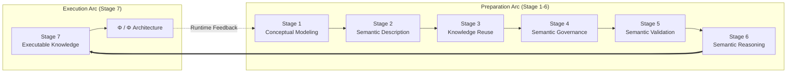

<!-- SPDX-License-Identifier: CC-BY-NC-SA-4.0 -->
# Chapter 27 - SKDL Synthesis & Volume 4 Conclusion

**From Seven Stages to One Architecture**

Chapter 26 closed **Stage 7**. The five execution primitives were consolidated into a single anatomy, examined from four perspectives, and shown to constitute the $\Theta/\Phi$ architecture that connects semantic reasoning to operational action.

This chapter does what no single stage can do: it steps back and views the entire Semantic Knowledge Development Lifecycle (SKDL) as one system.

It asks:

*"How do the seven stages work together -- and what does the whole lifecycle deliver that no single stage can?"*

The answer is not a new construct. It is an *architecture* -- a way of seeing the seven stages as a single, closed loop in which each stage prepares some part of $\Theta$ or $\Phi$, each later practice keeps the loop closed, and executable ontology is the artifact through which the entire SKDL demonstrates its value.

This is the final chapter of Volume 4b. It closes the SKDL arc, marks Volume 4's architectural milestone, and looks forward to Volume 5.

Table of Contents
- [27.1 Chapter Introduction](#271-chapter-introduction)
- [27.2 Learning Objectives](#272-learning-objectives)
- [27.3 The Seven-Stage Lifecycle as a Single System](#273-the-seven-stage-lifecycle-as-a-single-system)
  - [27.3.1 The Lifecycle at a Glance](#2731-the-lifecycle-at-a-glance)
  - [27.3.2 The Two Arcs: Preparation and Execution](#2732-the-two-arcs-preparation-and-execution)
  - [27.3.3 Why the Lifecycle Is Not a Checklist?](#2733-why-the-lifecycle-is-not-a-checklist)
- [27.4 The Journey from Ontology to Executable Models](#274-the-journey-from-ontology-to-executable-models)
  - [27.4.1 Three Artifacts, One Architecture](#2741-three-artifacts-one-architecture)
  - [27.4.2 The Artifact Hand-Off Chain](#2742-the-artifact-hand-off-chain)
  - [27.4.3 What the Journey Demonstrates?](#2743-what-the-journey-demonstrates)
- [27.5 Language and Paradigm Integration](#275-language-and-paradigm-integration)
  - [27.5.1 The Bridge Between Conceptual Ontologies and Graph Implementations.](#2751-the-bridge-between-conceptual-ontologies-and-graph-implementations)
  - [27.5.2 Two Graph Approaches, One Semantic Contract](#2752-two-graph-approaches-one-semantic-contract)
  - [27.5.3 Reusable Patterns, Constraints, and Rules -- Consolidated](#2753-reusable-patterns-constraints-and-rules----consolidated)
- [27.6 Best Practices in Semantic Engineering](#276-best-practices-in-semantic-engineering)
  - [27.6.1 Design Principles](#2761-design-principles)
  - [27.6.2 Governance and Quality Control](#2762-governance-and-quality-control)
  - [27.6.3 From Stage-7 Guidelines to Lifecycle Best Practices](#2763-from-stage-7-guidelines-to-lifecycle-best-practices)

## 27.1 Chapter Introduction

Volume 4b has walked the Semantic Knowledge Development Lifecycle from **Stage 6** (Semantic Reasoning) through **Stage 7** (Executable Knowledge) to the threshold of synthesis.

Chapter 23 established the reasoning layer ($R$): the discipline of deriving new, logically entailed knowledge from a validated ontology. Chapter 24, 25, and 26 built the $\Theta/\Phi$ architecture across three layers -- boundary, value, integrity -- and closed the design-pattern family that began in Chapter 22 (in Volume 4a).

The SKDL now has all seven of its stages:

1. **Conceptual Modeling** -- identify concepts and organize them into a taxonomy
2. **Semantic Description** -- enrich concepts with formal meaning
3. **Knowledge Reuse** -- transform validated knowledge into reusable assets
4. **Semantic Governance** -- maintain semantic integrity across the ecosystem
5. **Semantic Validation** -- verify correctness before deployment
6. **Semantic Reasoning** -- derive new knowledge through automated inference
7. **Executable Knowledge** -- operationalize knowledge for deterministic action

Each stage has its own primitives, its own perspectives, and its own engineering discipline.

**What the SKDL has not yet done -- in this volume -- is view all seven stages as a single system.**

This chapter does this.

It has three tasks:

1. **To show the seven stages as one architecture** -- not a list of seven steps, but a closed loop in which each stage prepares the next.
2. **To consolidate the patterns, practices, and architectural foundations** that the volume has developed -- the OWL design-pattern family, the $\Theta/\Phi$ architecture, and the engineering discipline that keeps the loop closed.
3. **To close Volume 4 and prepare the transition to Volume 5** -- the advanced volumes that take the foundation this volume has built and apply it to enterprise-scale, production-grade, integration-heavy scenarios.

**Key Insight:**

> "The SKDL is not seven stages performed in sequence. It is one architecture, expressed in seven dimensions. Each dimension is necessary; none is sufficient alone. The whole is what makes the ontology executable."

## 27.2 Learning Objectives

After completing this chapter, you should be able to achieve the following learning outcomes:

**Knowledge:**

- Explain why the SKDL is a lifecycle and not a checklist
- Trace the two arcs -- preparation and execution -- across the seven stages
- Map each stage's contribution to the $\Theta/\Phi$ architecture
- Explain the difference between the journey from ontology to executable models and the journey from conceptual model to production graph
- Describe the two graph approaches the book has developed and the semantic contract that unifies them
- Understand the difference between Stage-7-specific guidelines and lifecycle best practices

**Practical Skills:**

- Use the seven-stage lifecycle as a diagnostic tool when an executable ontology fails
- Identify which stage's contribution is missing when a $\Theta$ trigger or $\Phi$ execution fails
- Select the appropriate reusable pattern for a modeling or execution problem
- Design a lifecycle-aware governance plan for an executable ontology

**Engineering Perspective:**

- Understand that the executable ontology is the *artifact* of the whole SKDL, not just of Stage 7
- Explain how runtime feedback (validation, governance, process mining) keeps the $\Theta \to \Phi$ loop closed
- Apply lifecycle best practices (modularity, scalability, maintainability, governance) across all sevel stages

**Architectural Perspective:**

- Explain $\Theta/\Phi$ architecture as the through-line of the SKDL
- Articulate why the executable ontology is the artifact through which the SKDL demonstrates its value
- Preview the advanced volumes (Volume 5, 6, 7) and their relationship to the foundation this volume has built.

## 27.3 The Seven-Stage Lifecycle as a Single System

### 27.3.1 The Lifecycle at a Glance

The SKDL's seven stages are often presented as a linear progression. That presentation is useful pedagogically  -- it gives each chapter a clear scope and a clear hand-off -- but it is not architecturally accurate.

Architecturally, the seven stages are **two arcs of a single loop**:

- **The preparation arc** (Stages 1-6): the ontology is constructed, enriched, governed, validated, and reasoned over.
- **The execution arc** (Stage 7): the ontology is operationalized, connected to triggers and execution mechanisms, and deployed.

The two arcs meet at Stage 6 $\to$ Stage 7, where reasoning produces the classifications that execution acts on, and at Stage 7 $\to$ Stage 1, where runtime feedback (validation failures, governance deviations, process mining insights) refines the ontology for the next iteration.

The loop is the point. A lifecycle that does not close is not a lifecycle; it is a one-time construction project. The SKDL's discipline is the **the ontology is never finish** -- it is continuously refined by what the execution arc reveals.

**Key Insight:**

> "The preparation arc builds the ontology. The execution arc uses it. The feedback from execution refines the ontology. This is the SKDL -- not a pipeline, but a loop."

### 27.3.2 The Two Arcs: Preparation and Execution

The distinction between the two arcs matters because they have **different failure modes** and **different engineering disciplines**.

| Dimension | Preparation Arc (Stage 1-6) | Execution Arc (Stage 7) |
| --- | --- | --- |
| **Question** | What is true? What else can be derived? | What should happen, given what we know? |
| **Primary concern** | Semantic correctness and logical soundness | Determinism, completeness, and operational safety |
| **World assumption** | Open World (OWL default) | Closed World ( for the parts that execute) |
| **Dominant tool** | Reasoner (consistency + classification) | Runtime (BPMN, DMN, MES) + validation bridge (SHACL) |
| **Primary failure mode** | Inconsistency, unsatisfiability, wrong taxonomy | Quiet failure (rule does not fire; incomplete data) |
| **Recovery mechanism** | Return to Stage 1, 2, 4, or 5 | Runtime validation, exception workflows, feedback loops |

This table is one of the most useful diagnostic tools in the SKDL. When an executable ontology misbehaves, the first question is: **which arc is the failure in?**

- If the failure is in the *preparation arc* -- a taxonomy error, a missing disjointness, a mis-modeled restriction -- no amount of Stage 7 engineering will fix it. The recovery is to go back. (This is the golden rule of §26.9.1).
- If the failure is in the *execution arc* -- missing data, incomplete validation, a trigger that fires on the wrong condition -- the recovery is to strengthen the integrity layer, the validation bridge, or the runtime governance.

**Key Insight:**

> "The preparation arc asks what is true. The execution arc asks what should be done. They have different failure modes. Diagnose the arc before fixing the fault."

### 27.3.3 Why the Lifecycle Is Not a Checklist?

The most common misreading of the SKDL is to treat it as a **checklist**: perform Stage 1, then Stage 2, then Stage 3, and so on. The checklist reading is **wrong** for three reasons:

**First, the stages are not independent.** Stage 7 depends on Stage 6, which depends on Stage 5, and so on back to Stage 1. An error at Stag 1 propagates through every subsequent stage. The `PepperoniTopping` misclassification in Chapter 26's Exercise 26 is the canonical example: a Stage 1 taxonomy error prevented the reasoner from providing distinctness at Stage 7.

**Second, the stages are not strictly sequential.** In practice, the stages interleave. A validation failure at Stage 5 may send the engineer back to Stage 2. A reasoning surprise at Stage 6 may reveal a Stage 4 governance gap. The lifecycle is a **loop**, not a **line** -- and within the loop, work happens in the order the ontology needs it, not in the order the numbers suggest.

**Third, the stages are not just performed -- they are *inherited*.** The output of each stage becomes the input of the next, and the *quality* of that output constrains what the next stage can do. A well-governed Stage 4 makes Stage 5 cheap; a poorly validated Stage 5 makes Stage 6 unreliable; an unreliably reasoned Stage 6 makes Stage 7 unsafe.

**Key Insight:**

> "The SKDL is not a checklist because the stages are not independent. Each stage's output becomes the next stage's input, and the quality of that output constrains what the next stage can do. A checklist can be skipped; a lifecycle cannot."

## 27.4 The Journey from Ontology to Executable Models

### 27.4.1 Three Artifacts, One Architecture

The book has, across its volumes, developed three concrete artifacts:

1. **The Protégé ontology** -- the formal OWL model, authored in Protégé, checked by the reasoner, and governed by the SKDL.
2. **The Neo4j graph** -- the property-graph implementation, used for traversal, querying, and integration with enterprise graph databases.
3. **The prototyping work** -- the executable models (BPMN, DMN, MES actions) that operationalize the ontology's classifications.

These are often treated as three separate projects.

**However, they are three views of ONE architecture.**

- The **Protégé ontology** is the *semantic* layer: it holds the classes, properties, axioms, and inferences that make the domain machine-understandable.
- The **Neo4j graph** is the *operational* layer for graph-structured queries and traversals: it materializes the ontology's semantics as a queryable graph.
- The **prototyping work** is the *execution* layer: it connects the ontology's inferred classifications to triggers, workflows, and actions.

None of them is the architecture on its own. **The architecture is the contract among them** -- the way the semantic layer, the operational graph, and the execution layer exchange meaning.

**Key Insight:**

> "The Protégé ontology, the Neo4j graph, and the executable prototypes are not three projects. They are three views of one architecture -- and the architecture is what connects them"

### 27.4.2 The Artifact Hand-Off Chain

The three artifacts hand off to each other in a chain that mirrors the SKDL:

| SKDL Stage(s) | Artifact | What It Contributes |
| :-: | --- | --- |
| 1-2 | Protégé ontology | Concepts and formal meaning |
| 3-4 | Protégé ontology | Reuse patterns and governance policies |
| 5-6 | Protégé ontology | Validation and inferred classifications |
| **6 $\to 7** | **Neo4j graph** | **Materialized inferences and queryable structure** |
| **7** | **Executable prototypes** | **Triggers and execution mechanisms** |
| **7 \to 1** | **Runtime feedback** | **Refined ontology** |

The hand-off from Stage 6 to Stage 7 is where the Protégé ontology's inferences become the Neo4j graph's *materialized* knowledge. The hand-off from Stage 7 to Stage 1 is where the execution layer's runtime data becomes the ontology's *refinement signal*.

This chain is what makes the SKDL a *loop* rather than a *pipeline*.

**Key Insight:**

> "The hand-off chain from ontology to graph to execution is not a one-way transfer. It is a loop. The execution layer's output refines the ontology, and the refined ontology re-enters the hand-off chain."

### 27.4.3 What the Journey Demonstrates?

The journey from ontology to executable models demonstrates three architectural claims the volumes has made:

1. **The ontology is not the end product; it is the semantic foundation.** A well-governed ontology enables a well-integrated graph; a well-integrated graph enables a well-executed prototype.
2. **Integration is the hard part.** Michael DeBellis's observation (from his foreword) is directly relevant: *"The hard part isn't writing software, the hard part is integration."* The SKDL exists precisely to make integration principled rather than ad hoc.
3. **The architecture is what survives across technologies.** Protégé, Neo4j, and the executable prototypes are tools. The architecture -- the $\Theta \to \Phi$ loop, the two arcs, the hand-off chain -- is what survives when the tools change.

**Key Insight:**

> "The journey from ontology to executable models is not a tour of three tools. It is a demonstration that the architecture -- the semantic contract among ontology, graph, and execution -- is what carries the domain's meaning across the integration."

## 27.5 Language and Paradigm Integration

### 27.5.1 The Bridge Between Conceptual Ontologies and Graph Implementations.

The SKDL's contribution is not a new formalism. **It is a bridge.**

The bridge connects two things that are often treated as separate:

- **Conceptual ontologies** -- the formal, logic-based, reasoner-executable semantic models authored in OWL.
- **Graph implementation** -- the property-graph databases, triple stores, and query engines that materialize semantic models for production.

The bridge has three parts:

1. **A shared semantic contract** -- the classes, properties, and axioms of the ontology are the same concepts the graph implementation stores and queries.
2. **A materialization discipline** -- the ontology's inferences become the graph's materialized facts, so that queries and traversals reflect the full entailment of the ontology, not just the asserted axioms.
3. **A feedback mechanism** -- the graph implementation's runtime observations (query patterns, data quality, usage patterns) feed back into the ontology's governance and refinement.

The bridge is not automatic. It requires *engineering* -- and that is what the SKDL's stages provide.

**Key Insight:**

> "The SKDL's contribution is not a new language. It is a bridge -- a principled way to connect the formal semantics of the ontology to the operational requirements of the graph implementation."

### 27.5.2 Two Graph Approaches, One Semantic Contract

The book has developed **two different graph approaches** across its volumes:

- **The RDF/OWL approach** -- the semantic-web stack: RDF triples, OWL axioms, SPARQL queries, and reasoners.
- **The property-graph approach** -- the LPG (labeled property graph) stack: nodes with labels and properties, edges with types and properties, and query language like Cypher.

These approaches are often pitted against each other.

**The SKDL treats them as two implementations of the same semantic contract.**

| Dimension | RDF/OWL | Property Graph (LPG) |
| --- | --- | --- |
| **Semantic foundation** | Model-theoretic semantics, Description Logic | Application-defined semantics, usually no formal model theory |
| **Reasoning** | Native (reasoners implement DL inference) | Often external (via rules or precomputed) |
| **Schema** | Explicit (OWL classes, properties) | Flexible (labels, properties, no schema by default) |
| **Query** | SPARQL (declarative, graph-pattern-based) | Cypher / Gremlin (declarative, path-based) |
| **SKDL role** | Semantic layer ($\Theta$ construction) | Operational layer ($\Phi$ materialization and query) |

The two approaches are **not competitor**. They are *complementary implementation strategies* for the same semantic contract. The SKDL chooses between them based on operational requirements, not on ideology.

The bridge between them -- the materialization discipline -- is what makes the SKDL's integration claim concrete: the same ontology can be materialized into an RDF/OWL store for reasoner-driven applications, or into a property-graph store for traversal-driven application, and the semantic contract remains intact。

**Key Insight:**

> "The RDF/OWL approach and the property-graph approach are not competing paradigms. They are two implementation strategies for the same semantic contract. The SKDL's integration claim is that the contract survives the choice of implementation."

### 27.5.3 Reusable Patterns, Constraints, and Rules -- Consolidated

The volume has developed a family of reusable patterns across its chapters. The full Stage 7 design-pattern family is:

| Pattern | Purpose | Introduced |
| --- | --- | --- |
| **Probe Class** | Detects membership through a discriminating marker; validates infrastructure | Chapter 22 |
| **Closure Axiom** | Closes the world around a boundary | Chapter 24 |
| **Enumerated Class** | Closes the value domain of a property | Chapter 25 |
| **`hasValue` Restriction** | Binds a property to a specific value from a closed domain | Chapter 25 |
| **Cardinality Restriction** | Enforces data completeness | Chapter 26 |
| **Definition/Closure Separation** | Two-tier modeling pattern that resolves the closure-inheritance conflict | Chapter 26 |

Beyond the design patterns, the volume has consolidated three categories of reusable engineering artifacts:

1. **Constraints** -- the SHACL-based closed-world validation that bridges $\Theta$ to $\Phi$ (Chapter 26 §26.7.2), and the governance constraints the Stage 4 established.
2. **Rules** -- the SWRL rules and rule engines (Chapter 23 §23.7) that extend the reasoner's expressivity beyond OWL DL, and the DMN decision tables that externalize business rules from process flow (Chapter 26 §26.7.3).
3. **Architectural Patterns** -- the $\Theta/\Phi$ architecture itself, the two arcs, and the hand-off chain.

These are the reusable assets the SKDL provides. They are what makes the lifecycle *repeatable* -- not just a one-time narrative, but a library of proven solutions that can be applied to new domains.

**Key Insight:**

> "The reusable patterns, constraints, and rules are the SKDL's library. They are what makes the lifecycle *repeatable* rather than *recountable* -- a toolkit, not a story."

## 27.6 Best Practices in Semantic Engineering

### 27.6.1 Design Principles

The volume has developed three design principles that cut across the SKDL's stages.

**Maintainability.** An ontology must be maintainable by engineers who did not write it. Maintainability requires:

- **Modularity** -- dividing the ontology into coherent modules with clear boundaries.
- **Naming Discipline** -- consistent naming conventions that make the ontology legible.
- **Documentation** -- annotations, comments, and external documentation that explain the intent behind each axiom.
- **Traceability** -- every axiom should trace back to a requirement, a governance policy, or a design decision.

**Scalability.** An ontology must scale to enterprise size -- in *volume* (number of individuals), in *complexity* (number of axioms), and in *scope* (number of domains). Scalability requires:

- **Reasoning Performance** -- choosing the right OWL profile (DL vs. EL) and the right reasoner for the workload (Chapter 23 §23.7).
- **Query Optimization** -- designing the graph implementation to support the queries that matter.
- **Modularity at the Architecture Level** -- separating the semantic layer from the operational layer so that each can scale independently.

**Modularity.** An ontology must be composable -- its modules should be reusable in other ontologies, and its patterns should be applicable across domains. Modularity requires:

- **Pattern Reuse** -- applying the design-pattern family consistently.
- **Import Discipline** -- explicit and governed ontology imports, not ad hoc copying.
- **Interface Contracts** -- clean boundaries between modules so that changes in one do not ripple through others.

**Key Insight:**

> "Maintainability, scalability, and modularity are not optional. They are the difference between an ontology that works in a demo and one that works in production."

### 27.6.2 Governance and Quality Control

The SKDL's governance practices (established at Stage 4) and validation practices (established at Stage 5) are the backbone of its quality control. The volume has consolidated these practices into a coherent set:

**Governance.** Governance is the discipline of maintaining semantic integrity across an evolving ecosystem. It includes:

- **Policy Definition** -- explicit policies for naming, module structure, and axiom conventions.
- **Review Processes** -- reviews of ontology changes that assess semantic impact, not just syntactic validity.
- **Versioning** -- versioning of the ontology and its constraints, with clear deprecation policies.
- **Auditability** -- records of who changed what, when, and why.

**Validation.** Validation is the discipline of verifying that the ontology is logically consistent, semantically complete, and fit for purpose. It includes:

- **Consistency Checking** -- the reasoner's consistency check, run frequently.
- **Constraint Validation** -- SHACL shapes that encode the closed-world obligations the reasoner cannot check.
- **Data Quality Validation** -- checks that the instance data satisfies the required constraints.
- **Runtime Validation** -- checks performed by the execution system to ensure sufficient trusted data before acting.

The two practices are complementary. Governance *prevents* problems by making practices the default; validation *detects* problems when they occur. Together, they are the quality control that makes the SKDL's output **trustworthy**.

**Key Insight:**

> "Governance prevents problems by making good practice the default. Validation detects problems when they occur. Neither is sufficient alone. Together, they are the discipline that keeps the SKDL's output trustworthy."

### 27.6.3 From Stage-7 Guidelines to Lifecycle Best Practices

Chapter 26 §26.9 introduced a set of engineering guidelines for executable knowledge. Those guidelines were **Stage-7-specific** -- they answered the question: *"How do we build an executable ontology?"*

This chapter's best practices are **lifecycle-wide** -- they answer the question: *"How do we build an executable ontology that is maintainable, scalable, modular, and governable across all seven stages?"*

The difference in scope is the point. Stage 7's guidelines keep *execution* sound. The lifecycle's best practices keep the *architecture* sound.

| Scope | Guidelines | Concern |
| --- | --- | --- |
| **Stage 7** | §26.9.1-§26.9.7 | Correctness of execution |
| **Whole SKDL** | §27.6.1-§27.6.2 | Maintainability, scalability, modularity, governance across all stages |

Both are necessary. A system that is correct at Stage 7 but unmaintainable across the lifecycle will not survive production. A system that is well-governed across the lifecycle but incorrect at Stage 7 will produce wrong inferences.

**Key Insight:**

> "Stage 7's guidelines keep the execution correct. The lifecycle's best practices keep the architecture maintainable. An executable ontology needs both."

---

Last updated at 2026-11-20