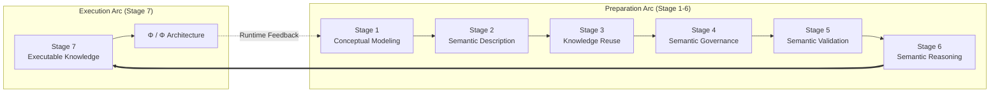

<!-- SPDX-License-Identifier: CC-BY-NC-SA-4.0 -->
# Chapter 27 - SKDL Synthesis & Volume 4 Conclusion

**From Seven Stages to One Architecture**

Chapter 26 closed **Stage 7**. The five execution primitives were consolidated into a single anatomy, examined from four perspectives, and shown to constitute the $\Theta/\Phi$ architecture that connects semantic reasoning to operational action.

This chapter does what no single stage can do: it steps back and views the entire Semantic Knowledge Development Lifecycle (SKDL) as one system.

It asks:

*"How do the seven stages work together -- and what does the whole lifecycle deliver that no single stage can?"*

The answer is not a new construct. It is an *architecture* -- a way of seeing the seven stages as a single, closed loop in which each stage prepares some part of $\Theta$ or $\Phi$, each later practice keeps the loop closed, and executable ontology is the artifact through which the entire SKDL demonstrates its value.

This is the final chapter of Volume 4b. It closes the SKDL arc, marks Volume 4's architectural milestone, and looks forward to Volume 5.

Table of Contents
- [27.1 Chapter Introduction](#271-chapter-introduction)
- [27.2 Learning Objectives](#272-learning-objectives)
- [27.3 The Seven-Stage Lifecycle as a Single System](#273-the-seven-stage-lifecycle-as-a-single-system)
  - [27.3.1 The Lifecycle at a Glance](#2731-the-lifecycle-at-a-glance)

## 27.1 Chapter Introduction

Volume 4b has walked the Semantic Knowledge Development Lifecycle from **Stage 6** (Semantic Reasoning) through **Stage 7** (Executable Knowledge) to the threshold of synthesis.

Chapter 23 established the reasoning layer ($R$): the discipline of deriving new, logically entailed knowledge from a validated ontology. Chapter 24, 25, and 26 built the $\Theta/\Phi$ architecture across three layers -- boundary, value, integrity -- and closed the design-pattern family that began in Chapter 22 (in Volume 4a).

The SKDL now has all seven of its stages:

1. **Conceptual Modeling** -- identify concepts and organize them into a taxonomy
2. **Semantic Description** -- enrich concepts with formal meaning
3. **Knowledge Reuse** -- transform validated knowledge into reusable assets
4. **Semantic Governance** -- maintain semantic integrity across the ecosystem
5. **Semantic Validation** -- verify correctness before deployment
6. **Semantic Reasoning** -- derive new knowledge through automated inference
7. **Executable Knowledge** -- operationalize knowledge for deterministic action

Each stage has its own primitives, its own perspectives, and its own engineering discipline.

**What the SKDL has not yet done -- in this volume -- is view all seven stages as a single system.**

This chapter does this.

It has three tasks:

1. **To show the seven stages as one architecture** -- not a list of seven steps, but a closed loop in which each stage prepares the next.
2. **To consolidate the patterns, practices, and architectural foundations** that the volume has developed -- the OWL design-pattern family, the $\Theta/\Phi$ architecture, and the engineering discipline that keeps the loop closed.
3. **To close Volume 4 and prepare the transition to Volume 5** -- the advanced volumes that take the foundation this volume has built and apply it to enterprise-scale, production-grade, integration-heavy scenarios.

**Key Insight:**

> "The SKDL is not seven stages performed in sequence. It is one architecture, expressed in seven dimensions. Each dimension is necessary; none is sufficient alone. The whole is what makes the ontology executable."

## 27.2 Learning Objectives

After completing this chapter, you should be able to achieve the following learning outcomes:

**Knowledge:**

- Explain why the SKDL is a lifecycle and not a checklist
- Trace the two arcs -- preparation and execution -- across the seven stages
- Map each stage's contribution to the $\Theta/\Phi$ architecture
- Explain the difference between the journey from ontology to executable models and the journey from conceptual model to production graph
- Describe the two graph approaches the book has developed and the semantic contract that unifies them
- Understand the difference between Stage-7-specific guidelines and lifecycle best practices

**Practical Skills:**

- Use the seven-stage lifecycle as a diagnostic tool when an executable ontology fails
- Identify which stage's contribution is missing when a $\Theta$ trigger or $\Phi$ execution fails
- Select the appropriate reusable pattern for a modeling or execution problem
- Design a lifecycle-aware governance plan for an executable ontology

**Engineering Perspective:**

- Understand that the executable ontology is the *artifact* of the whole SKDL, not just of Stage 7
- Explain how runtime feedback (validation, governance, process mining) keeps the $\Theta \to \Phi$ loop closed
- Apply lifecycle best practices (modularity, scalability, maintainability, governance) across all sevel stages

**Architectural Perspective:**

- Explain $\Theta/\Phi$ architecture as the through-line of the SKDL
- Articulate why the executable ontology is the artifact through which the SKDL demonstrates its value
- Preview the advanced volumes (Volume 5, 6, 7) and their relationship to the foundation this volume has built.

## 27.3 The Seven-Stage Lifecycle as a Single System

### 27.3.1 The Lifecycle at a Glance

The SKDL's seven stages are often presented as a linear progression. That presentation is useful pedagogically  -- it gives each chapter a clear scope and a clear hand-off -- but it is not architecturally accurate.

Architecturally, the seven stages are **two arcs of a single loop**:

- **The preparation arc** (Stages 1-6): the ontology is constructed, enriched, governed, validated, and reasoned over.
- **The execution arc** (Stage 7): the ontology is operationalized, connected to triggers and execution mechanisms, and deployed.

The two arcs meet at Stage 6 $\to$ Stage 7, where reasoning produces the classifications that execution acts on, and at Stage 7 $\to$ Stage 1, where runtime feedback (validation failures, governance deviations, process mining insights) refines the ontology for the next iteration.

The loop is the point. A lifecycle that does not close is not a lifecycle; it is a one-time construction project. The SKDL's discipline is the **the ontology is never finish** -- it is continuously refined by what the execution arc reveals.

**Key Insight:**

> "The preparation arc builds the ontology. The execution arc uses it. The feedback from execution refines the ontology. This is the SKDL -- not a pipeline, but a loop."

---

Last updated at 2026-11-15